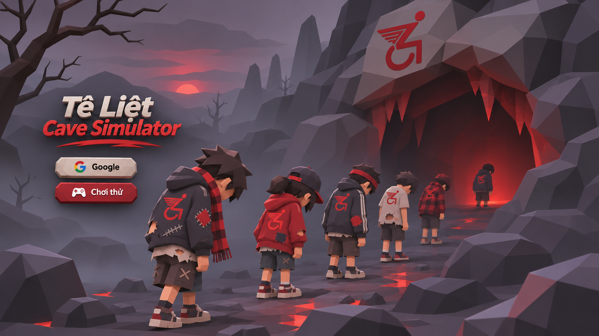

# Concept đăng nhập: low-poly 3D

Ảnh concept tĩnh đã được người dùng duyệt ngày 2026-11-11. Đây là hình minh họa phong cách low-poly 3D, không phải screenshot game, scene 3D, model hay animation đã triển khai.

## Hướng triển khai

- Màn hình đăng nhập mang tiêu đề **Tê Liệt / Cave Simulator**, bố cục như ảnh.
- Fan cúi đầu, dáng thất thểu, lần lượt đi vào hang từng người một với nhịp chậm.
- Trang phục hiện đại, cũ rách và có bản vá; hang tối, ánh sáng yếu, hình khối low-poly rõ.
- Dùng biểu tượng do người dùng cung cấp trong [ảnh gốc](../../references/user-symbol-reference.png). Chữ và biểu tượng trong ảnh AI chỉ là bản tái hiện concept; dựng lại khi triển khai, không dùng làm logo master.

Commit này chỉ bổ sung ảnh và ghi chú thiết kế. Chưa thay đổi màn hình đăng nhập, model hay chuyển động trong game. Quyền sử dụng thương mại của ảnh logo tham khảo chưa được xác minh; xem [art direction](../../../docs/art-direction.md).
