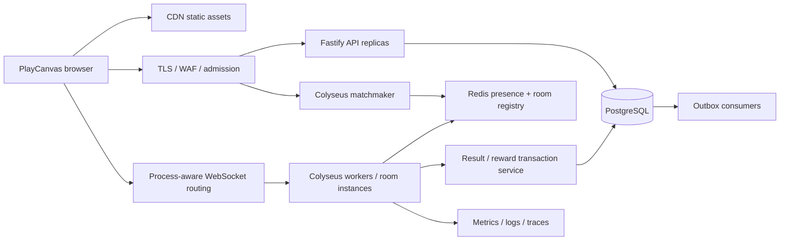

# Kiến trúc đích — Tê Liệt

Ngày quyết định: 09/11/2026. Trạng thái: thiết kế production, implementation ở foundation. Ưu tiên social hub trước; client thay được, server giữ luật chơi. Chưa cam kết 10k CCU cho đến khi có báo cáo tải tái lập.

## Ranh giới hệ thống

Một room nằm trong bộ nhớ **một process**, không chia tick qua Redis. Redis điều phối tìm phòng/presence, không lưu từng frame hoặc làm nguồn sự thật cho inventory. PostgreSQL lưu account, progression, reward ledger và audit. Static assets đặt trên CDN, path theo content hash; game server không phục vụ mesh/texture. Một region đầu tiên gần người chơi Việt Nam; không kéo một room xuyên region.

Fastify xử lý identity/profile/inventory và moderation. Colyseus xử lý matchmaking + realtime; không cố gắn Fastify vào transport nội bộ của Colyseus. SDK dùng room name có version `hub_v1`; thay đổi schema không tương thích tạo `hub_v2`, cho v1 drain trước khi gỡ client cũ.

## Capacity và mục tiêu nghiệm thu đề xuất

30 người tối đa/room, occupancy trung bình dự kiến 25. 10k CCU cần tối thiểu 334 room nếu luôn đầy, khoảng 400 room ở mức 25 người, cộng dự phòng 30%. Đây là phép tính slot, **không phải sizing CPU**. Số worker = ceil(10.000 / CCU đo được trên worker ở SLO) × 1,3; cần đo cả băng thông, heap và event-loop.

SLO đích trong một region: successful join ≥99,5%; join p95 <2 giây; RTT app p95 <150 ms trên đường mạng đại diện; tick execution p99 <25 ms với interval 50 ms; event-loop lag p99 <20 ms; lỗi session bất ngờ <0,5%/giờ. Không áp các ngưỡng mạng này cho mọi quốc gia. Theo dõi disconnect theo nguyên nhân để phân biệt người chơi tự thoát.

Nếu outbound trung bình 3 KB/s/client thì 10k CCU khoảng 30 MB/s ≈240 Mbps payload, chưa overhead/TLS/reconnect; phải thay giả định bằng đo đạc. State delta vẫn có worst-case gần N² trong từng room khi mọi avatar chuyển động. N=30 là ranh giới kiểm soát tải, không broadcast 10k người vào một scene.

## An toàn và vận hành trước public

Guest MVP cấp JWT ngắn hạn 15 phút; production chuyển sang account/session với refresh rotation và revoke. JWT có issuer/audience/expiry, không tin name/id/score do client gửi. Secret manager, key rotation/kid hoặc asymmetric key cho API ký, game verify. Token không log và không đặt query URL.

Cần thêm admission rate limit ở edge và Redis theo IP/account; rate limiter Fastify hiện chỉ per-process. Origin allowlist cho WebSocket và matchmaker; CORS không phải cơ chế xác thực. Payload WebSocket tối đa 4 KB, input schema strict; server tự clamp tốc độ và biên map. Ban/mute/report, block list, chat filtering, chống tạo guest hàng loạt phải hoàn thành trước public. Không lưu chat toàn cục mặc định; chỉ lưu bằng chứng report có TTL theo chính sách sản phẩm.

Logs JSON có request/room/process/build IDs; không log JWT hoặc chat text mặc định. Metrics: CCU, rooms, occupancy, seat reservation failures, join latency, reconnect success, tick time, event-loop delay, message/byte rates, heap/RSS, DB pool wait, Redis latency, outbox age. Trace HTTP join/reward; không trace mọi tick. Alert theo SLO burn-rate và queue backlog, không chỉ CPU.

## Tradeoff

Không Kubernetes ngay từ đầu: Compose cho local/single-host integration; managed PostgreSQL/Redis và game fleet trên VM/container orchestration khi có tải. Không AOI ở 30 người cho đến khi bandwidth profile yêu cầu. Không voice ở MVP. Không seamless room migration: room crash mất vị trí tạm thời, client vào phòng mới; kết quả minigame chỉ công nhận khi transaction đã commit. Không tự động coi Redis failover là phục hồi room state.

## Nguồn kỹ thuật

Version dependency chính xác trong package-lock.json; chọn nhánh Colyseus 0.17 cho baseline đồng nhất server/SDK/schema 4. Không suy diễn API 0.18 từ trang latest.

- [Colyseus 0.17 scalability](https://0-17.docs.colyseus.io/scalability): shared presence/driver và định tuyến process.
- [Colyseus 0.17 driver](https://0-17.docs.colyseus.io/server/driver): registry phục vụ matchmaking.
- [PlayCanvas standalone](https://developer.playcanvas.com/user-manual/engine/standalone/): npm/TypeScript engine workflow.

Các SLO, capacity và milestone ở đây là quyết định thiết kế của dự án, không phải benchmark từ các nguồn trên.
