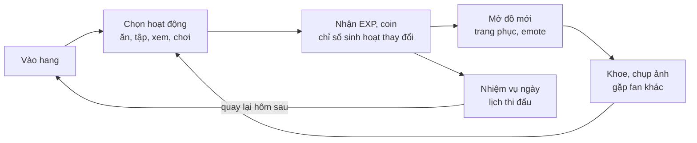
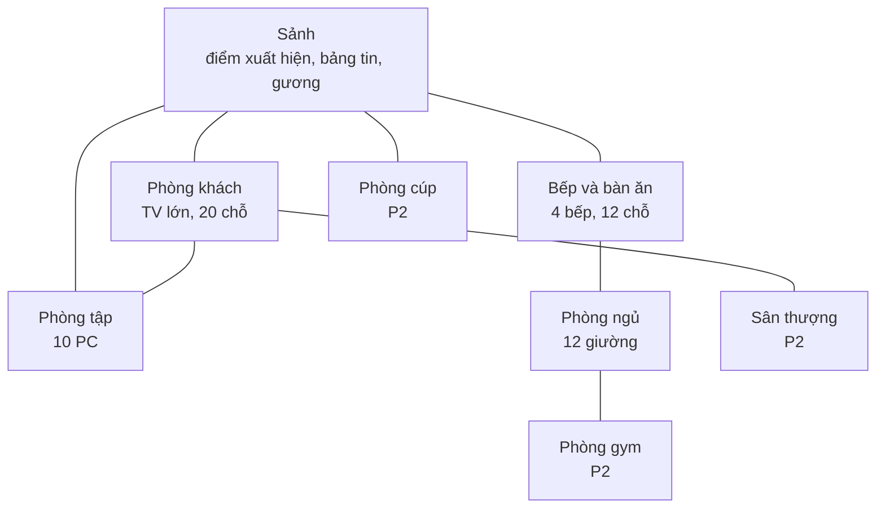
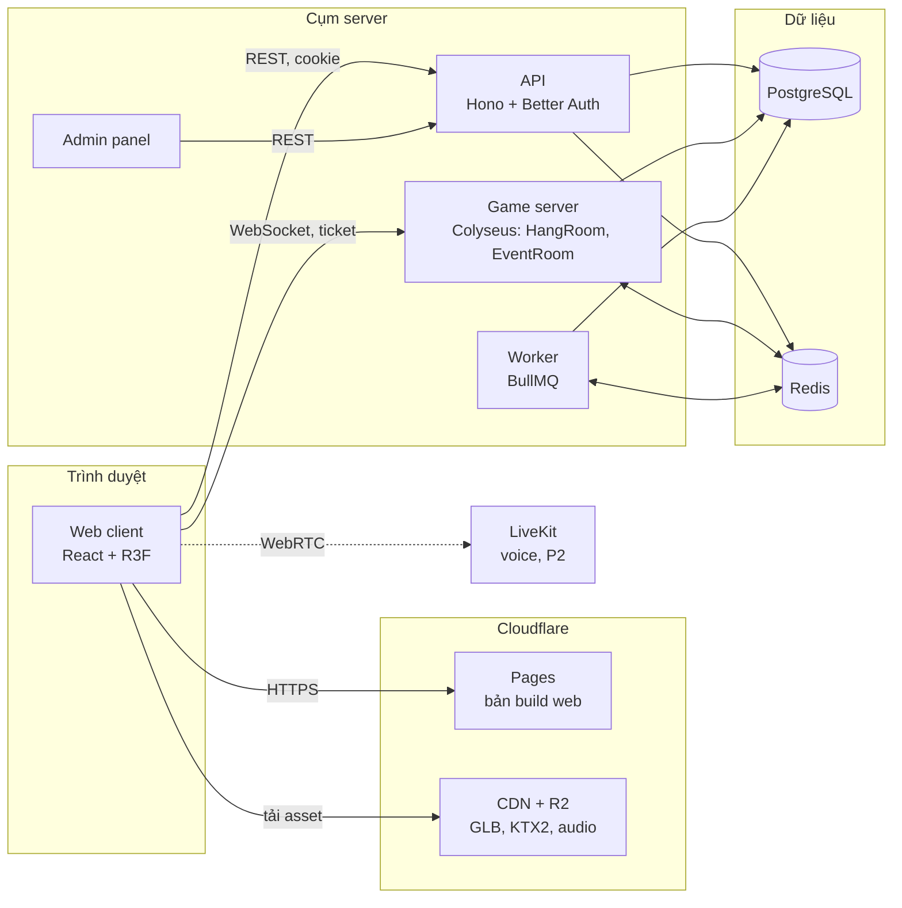
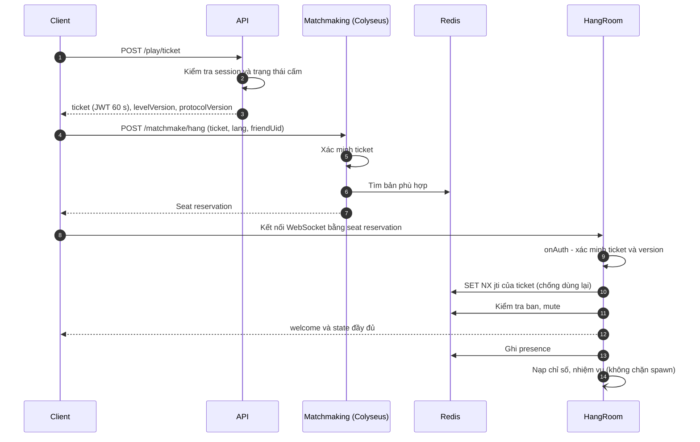
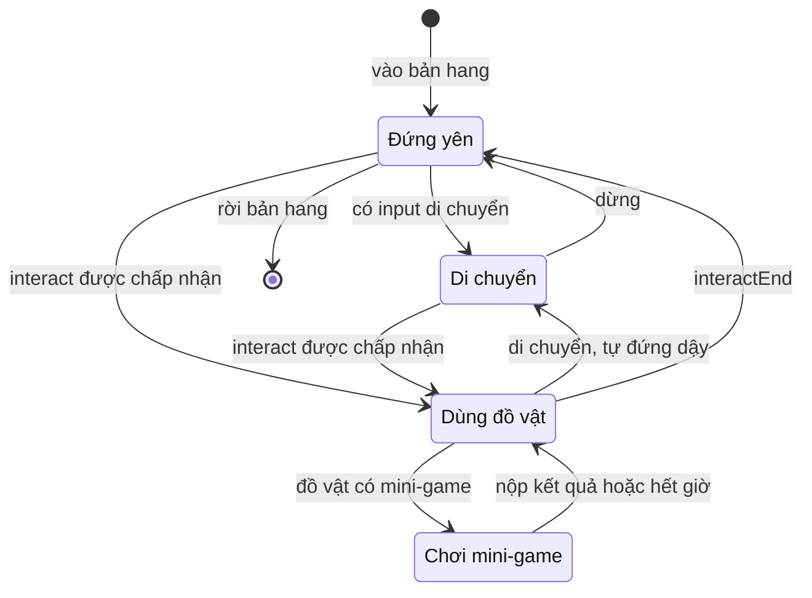
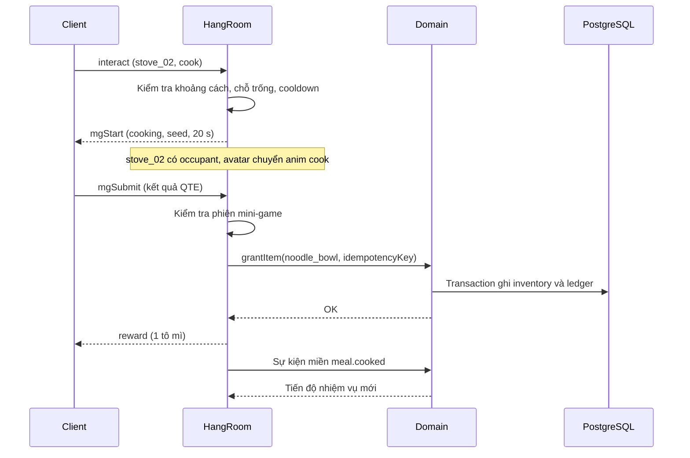
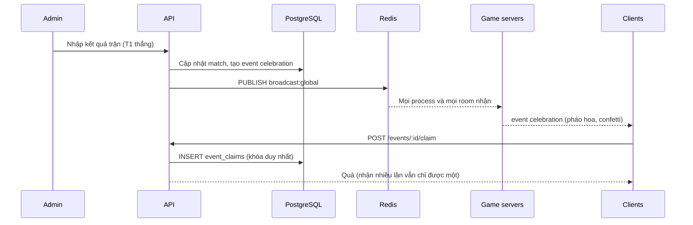
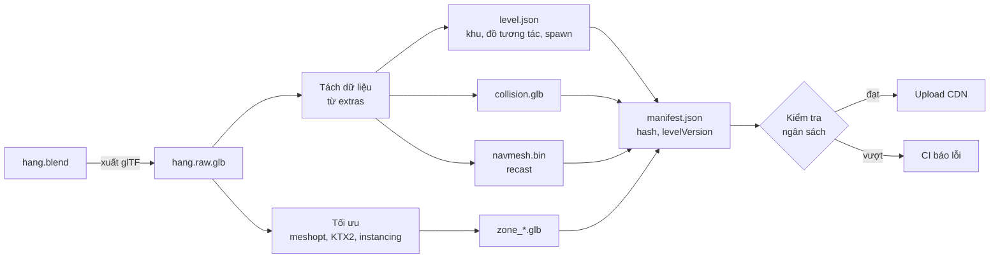

# T1 Hang — Tài liệu thiết kế

Web game 3D multiplayer mô phỏng sinh hoạt trong "hang" dành cho fan T1. Tài liệu gồm cả thiết kế gameplay và thiết kế kỹ thuật.

> **Trạng thái (09/11/2026): tài liệu tham khảo, không còn là nguồn yêu cầu.** Yêu cầu sản phẩm theo GDD "Tê Liệt" trong Design Concept Pack v1. Phương án kỹ thuật đã chốt ở `docs/tech-decisions.md` của repo `te-liet`. Phần dưới đây chỉ giữ lại để tra cứu, chủ yếu: lọc chat tiếng Việt (9.3), pháp lý Việt Nam (12), vận hành ngày có trận (10.4).

| | |
|---|---|
| Phiên bản | 0.1 (bản nháp) |
| Ngày | 2026-11-09 |
| Người phụ trách | HiepLV |
| Trạng thái | Tham khảo — yêu cầu đã thay bằng GDD Tê Liệt |

"T1 Hang" là tên tạm. Việc dùng tên và thương hiệu T1 cần xem mục 12 trước khi công bố.

**Cách đọc**
- Mọi người: mục 1–3 (sản phẩm, gameplay, trải nghiệm).
- Dev: mục 4–11.
- Lead, PM: mục 12–16.

**Lịch sử thay đổi**

| Phiên bản | Ngày | Thay đổi |
|---|---|---|
| 0.1 | 2026-11-09 | Bản nháp đầu tiên |

## Tóm tắt

- **Client:** Three.js + React Three Fiber, chạy trên trình duyệt desktop và mobile. Asset dựng trong Blender, xuất GLB nén Meshopt/KTX2.
- **Realtime:** Colyseus. Mỗi bản hang là một room tối đa 50 người, nhiều bản chạy song song. Ngày có trận mở thêm Khán đài 300 người.
- **Netcode:** client tự di chuyển, server kiểm tra. Mọi thứ có giá trị (chỗ ngồi, coin, đồ, nhiệm vụ) do server quyết định.
- **Backend:** modular monolith TypeScript. API (Hono), game server và worker dùng chung logic nghiệp vụ, chung PostgreSQL và Redis.
- **Nội dung:** map dựng trong Blender; dữ liệu đồ tương tác xuất ra `level.json` và navmesh, dùng chung cho client và server.
- **An toàn:** kiểm duyệt và chống raid có từ MVP. Toàn bộ branding gom vào một theme pack thay được.
- **Lộ trình:** khoảng 5 tháng đến public launch với đội 3–4 người.

## Mục lục

1. Tổng quan
2. Gameplay
3. Trải nghiệm người chơi
4. Kiến trúc hệ thống
5. Client
6. Game server và netcode
7. Backend và dữ liệu
8. Pipeline nội dung
9. Bảo mật, chống gian lận và kiểm duyệt
10. Hạ tầng và vận hành
11. Kiểm thử và ngân sách hiệu năng
12. Pháp lý và tuân thủ
13. Lộ trình và đội ngũ
14. Rủi ro
15. Quyết định kiến trúc (ADR)
16. Câu hỏi mở

Phụ lục A: Thuật ngữ · Phụ lục B: Hằng số cân bằng khởi điểm · Phụ lục C: Quy ước phát triển

---

## 1. Tổng quan

### 1.1 Ý tưởng

T1 Hang là một không gian 3D chạy trên trình duyệt, nơi fan T1 cùng "sống" trong một gaming house cách điệu: đi lại, ngồi sofa tán gẫu, nấu mì, ngồi máy chơi "scrim", xem trận cùng nhau và ăn mừng khi đội thắng. Bấm link là vào, không cần cài đặt.

> Một câu: *gaming house của T1 mở cửa cho fan, vào bằng một đường link.*

### 1.2 Trụ cột thiết kế

| # | Trụ cột | Ý nghĩa | Hệ quả cho thiết kế |
|---|---|---|---|
| 1 | Chỗ an toàn | Fan không bị quấy rối, không bị phá | Kiểm duyệt có từ MVP, cấp tin cậy, công cụ chống raid |
| 2 | Vào là chơi | Từ lúc bấm link đến khi đứng trong hang ≤ 15 giây trên 4G | Guest mode, asset nhẹ, tải dần, không bắt đăng ký |
| 3 | Ở cùng nhau | Luôn thấy người khác; làm cùng nhau thì được thưởng | Ăn chung, xem chung, cổ vũ đồng loạt |
| 4 | Sinh hoạt có nhịp | Hoạt động ngắn (30 giây–3 phút), có lý do quay lại mỗi ngày | Nhiệm vụ ngày, chỉ số sinh hoạt, bám lịch thi đấu thật |

Khi hai lựa chọn thiết kế xung đột, trụ cột có số nhỏ hơn thắng. Ví dụ: hạn chế chat của guest (an toàn) được ưu tiên hơn việc để guest làm mọi thứ ngay (vào là chơi).

### 1.3 Người chơi mục tiêu

- Chính: fan T1 ở Việt Nam, khoảng 15–30 tuổi, chơi bằng điện thoại Android tầm trung và laptop.
- Mở rộng: fan quốc tế (tiếng Anh, tiếng Hàn).
- Thói quen: ghé vài phút mỗi ngày; ở lại 1–3 giờ vào ngày T1 thi đấu.

### 1.4 Phạm vi

**MVP (closed beta)**
- 5 khu: Sảnh, Phòng tập, Phòng khách, Bếp, Phòng ngủ.
- Avatar tùy biến, emote, chat theo khu.
- Đồ tương tác (ngồi, nấu, ăn, ngủ, PC) và 2 mini-game (Scrim, Nấu mì).
- Chỉ số sinh hoạt, EXP và cấp, coin, cửa hàng trang phục, nhiệm vụ ngày.
- Bạn bè, vào cùng bản hang với bạn.
- Guest và đăng nhập Google/Discord.
- Kiểm duyệt, trang admin.
- Nhiều bản hang chạy song song.

**Public launch bổ sung**
- Khán đài, watch party, Độ cháy, ăn mừng khi thắng, "mì an ủi" khi thua.
- Co giãn hạ tầng theo lịch thi đấu.

**Không làm (ít nhất đến sau public launch)**
- Chiến đấu, PvP thời gian thực, mô phỏng lại LMHT.
- Giao dịch giữa người chơi (tránh lừa đảo, mua bán đồ bằng tiền thật).
- Thanh toán bằng tiền thật.
- Nội dung người chơi tự đăng (ảnh, chữ tự do hiển thị công khai).
- App native.

### 1.5 Chỉ số thành công

| Chỉ số | Mục tiêu closed beta | Ghi chú |
|---|---|---|
| Thời gian từ bấm link đến vào hang (p75, 4G) | ≤ 15 s | Đo bằng RUM |
| Người chơi mới có tương tác đầu tiên trong 60 s | ≥ 70% | Phễu onboarding |
| Retention D1 / D7 | ≥ 30% / ≥ 12% | Mốc tham khảo, chỉnh sau beta |
| Thời lượng phiên trung vị | ≥ 12 phút | Ngày có trận: ≥ 40 phút |
| Guest liên kết tài khoản trong 7 ngày | ≥ 25% | |
| Phiên không crash | ≥ 99% | Sentry |
| Báo cáo vi phạm trên 1.000 tin nhắn | Theo dõi xu hướng | Cảnh báo khi tăng đột biến |

---

## 2. Gameplay

### 2.1 Vòng lặp chính



Ngày có trận có vòng riêng: thông báo trước trận → tụ tập ở phòng khách hoặc Khán đài → cổ vũ, Độ cháy tăng → có kết quả → ăn mừng (pháo hoa, quà) hoặc "mì an ủi".

### 2.2 Bản đồ hang

Một tầng, khoảng 32 m × 24 m. Phong cách gaming house hiện đại tông đỏ–đen–trắng, ánh sáng ấm, đèn RGB ở phòng tập.



| Khu | Giai đoạn | Đồ tương tác chính | Chỗ ngồi/nằm | Vai trò |
|---|---|---|---|---|
| Sảnh | MVP | Bảng tin, gương thay đồ ×2, ghế chờ ×4 | 4 | Điểm xuất hiện, lịch trận, tùy biến avatar |
| Phòng tập | MVP | PC ×10 | 10 | Mini-game Scrim, bảng xếp hạng tuần |
| Phòng khách | MVP | TV lớn, sofa 12 chỗ, đệm ngồi ×8 | 20 | Tụ tập, xem trận |
| Bếp | MVP | Bếp ×4, tủ lạnh, bàn ăn 8 chỗ, quầy 4 chỗ | 12 (+4 chỗ đứng nấu) | Mini-game Nấu mì, ăn chung |
| Phòng ngủ | MVP | Giường tầng ×6 | 12 | Hồi năng lượng |
| Phòng gym | P2 | Máy chạy, tạ | 6 | Mini-game nhịp điệu |
| Phòng cúp | P2 | Tủ cúp cách điệu, góc chụp ảnh, tường fan | — | Chụp ảnh, kỷ niệm |
| Sân thượng | P2 | Ghế, lan can | 10 | Sự kiện buổi tối, pháo hoa |
| Phòng riêng | P3 | Đồ trang trí | — | Mỗi người tự trang trí, mời bạn tới |

Tổng chỗ ngồi/nằm ở MVP là 62, nhiều hơn sức chứa 50 của một bản hang, để không ai phải đứng vì hết chỗ.

### 2.3 Hoạt động

| Hoạt động | Ở đâu | Thời lượng | Tác động | Ghi chú |
|---|---|---|---|---|
| Ngồi nghỉ | Ghế, sofa, đệm | Tùy ý | Năng lượng +1 / 10 s | Bong bóng chat hiện trên đầu |
| Xem trận | Phòng khách, Khán đài | Theo trận | Hứng khởi +1 / 30 s | Chế độ rạp, xem 2.8 |
| Scrim | PC | 60 s | EXP, coin theo điểm; Năng lượng −10 | Xem 2.5 |
| Nấu mì | Bếp | 20 s | Nhận một "tô mì" | Mini-game QTE |
| Ăn | Bàn ăn, quầy | 15 s | No bụng +40 | ≥ 3 người ăn cùng bàn trong 60 s → buff "Cơm team" (EXP +10% trong 30 phút) |
| Ngủ | Giường | Tùy ý | Năng lượng +2 / 10 s | |
| Cổ vũ | Mọi nơi | Tức thì | Hứng khởi +1 (tối đa +10/phút) | Cộng vào Độ cháy khi có trận |
| Emote | Mọi nơi | 2–5 s | — | Vẫy tay, vỗ tay, nhảy… |
| Thay đồ | Gương ở Sảnh | Tùy ý | — | Mở tủ đồ |
| Chụp ảnh | Mọi nơi | — | — | Ẩn UI, chia sẻ bằng Web Share API |

### 2.4 Chỉ số sinh hoạt

Ba chỉ số từ 0 đến 100, hiện bằng biểu tượng nhỏ trên HUD.

| Chỉ số | Giảm khi | Tăng khi | Thấp (< 20) | Cao (≥ 70) |
|---|---|---|---|---|
| Năng lượng | Chơi Scrim (−10/lượt) | Ngủ (nhanh), ngồi nghỉ (chậm) | Thưởng Scrim ×0,5; avatar ngáp | — |
| No bụng | Online (−1 mỗi 2 phút) | Ăn | Avatar xoa bụng | EXP +10% |
| Hứng khởi | Online (−1 mỗi 3 phút) | Cổ vũ, xem trận, T1 thắng | — | Coin +10%; hiệu ứng lửa quanh avatar |

Nguyên tắc:
- Chỉ số không bao giờ chặn hoạt động, chỉ đổi phần thưởng và biểu cảm của avatar.
- Không giảm khi offline: người chơi quay lại sau một tuần vẫn thấy avatar như lúc rời đi.
- Chỉ số là tín hiệu xã hội: thấy avatar ngáp hay xoa bụng là biết người đó đang thế nào, dễ rủ nhau đi ăn, đi ngủ.

### 2.5 Mini-game

**Scrim** (PC, 60 giây). Trò phản xạ trừu tượng, không mô phỏng LMHT: mục tiêu xuất hiện theo nhịp, bấm đúng lúc để ghi điểm và nối combo. Server cấp `seed` cho mỗi lượt nên ai cũng gặp độ khó tương đương và server kiểm tra được điểm. Có bảng xếp hạng tuần.

**Nấu mì** (bếp, 20 giây). Ba bước QTE: đổ nước, canh lửa, thả trứng đúng lúc. Kết quả là mì Thường, Ngon hoặc Hoàn hảo; mì Hoàn hảo cho buff No bụng lâu hơn.

**P2:** Gym (nhịp điệu); Dự đoán tỉ số (tham gia miễn phí, đoán đúng thì nhận thưởng, không đặt cược coin).

Nguyên tắc chung:
- Chơi được bằng một ngón tay trên điện thoại.
- Phần thưởng có trần theo ngày, nên dù có người gian lận thì lợi ích cũng có giới hạn.
- Logic mini-game viết thuần, không phụ thuộc phần render, để server chạy lại được khi cần kiểm tra (6.8).

### 2.6 Tiến trình và kinh tế

- **EXP → cấp độ:** mở danh hiệu, khung tên và một số trang phục theo cấp.
- **Coin:** tiền trong game, chỉ kiếm được bằng cách chơi, không mua bằng tiền thật, không chuyển cho người khác.

| Nguồn coin | Mức | Giới hạn |
|---|---|---|
| Scrim | 10–60 / lượt | Tổng coin từ mini-game ≤ 600/ngày |
| Nấu mì | 5–20 / lượt | Chung giới hạn trên |
| Nhiệm vụ ngày | 50–100 / nhiệm vụ | 3 nhiệm vụ/ngày |
| Chuỗi ngày đăng nhập | 20 → 100 (ngày thứ 7) | 1 lần/ngày |
| Sự kiện (T1 thắng, dịp đặc biệt) | 100–300 | 1 lần/sự kiện |

| Nơi tiêu coin | Giá |
|---|---|
| Trang phục, phụ kiện | 200–2.000 |
| Emote | 500–1.500 |
| Đồ trang trí phòng riêng (P3) | 100–3.000 |

Các con số là giá trị khởi điểm, sẽ chỉnh sau playtest. Mọi thay đổi coin đều ghi vào sổ cái (7.4).

**Nhiệm vụ**
- Ngày: 3 nhiệm vụ ngẫu nhiên từ một danh sách (vd "Ăn cùng bàn với 2 fan khác", "Đạt 1.000 điểm Scrim", "Cổ vũ 20 lần"). Reset lúc 00:00 giờ Việt Nam (GMT+7).
- Tuần: 1–2 nhiệm vụ lớn.
- Ngày có trận: nhiệm vụ riêng (vd "Xem trận 30 phút", "Cổ vũ 50 lần trong trận").

### 2.7 Xã hội

- **Chat khu** (mặc định): người cùng phòng thấy.
- **Loa:** cả bản hang thấy, 1 lần mỗi 60 giây, cần tài khoản đã liên kết.
- **Tin nhắn riêng** giữa bạn bè (P2).
- Bong bóng chat trên đầu avatar, bánh xe emote.
- **Bạn bè:** kết bạn, xem bạn đang ở bản hang nào, nút "Đến chỗ bạn".
- **An toàn:** chặn, tắt tiếng, báo cáo ngay từ bảng tên hoặc tin nhắn.
- **Voice theo khoảng cách** (P2), điều kiện sử dụng ở 9.5.

### 2.8 Sự kiện và xem trận

- **Lịch thi đấu** hiện trên bảng tin ở Sảnh và trong HUD; admin nhập.
- **Watch party:** TV phòng khách ở mọi bản hang dẫn tới stream chính thức. Ngồi sofa hoặc bấm vào TV để mở chế độ rạp (5.6).
- **Khán đài:** bản riêng cho ngày có trận, sức chứa 300, ai cũng ngồi ghế cố định, chỉ cổ vũ, emote và chat. Đông vui hơn phòng khách, và vì không ai di chuyển nên server chịu được nhiều người.
- **Độ cháy:** thanh cổ vũ chung của toàn server, tăng theo tổng lượt cổ vũ ở mọi bản. Đạt mốc thì mọi bản cùng bắn pháo hoa nhỏ.
- **Hết trận:**
  - T1 thắng: pháo hoa và confetti ở mọi bản, quà nhận trong 24 giờ.
  - T1 thua: sự kiện "mì an ủi", ai cũng được một tô mì, nhạc nền chuyển nhẹ nhàng.
- **Dịp đặc biệt:** gói trang trí theo mùa (theme pack) bật bằng remote config.

### 2.9 Avatar và tùy biến

- Đề xuất phong cách chibi/stylized: nhẹ, dễ nhận ra khi nhìn từ trên xuống, tránh vấn đề giống người thật (chờ chốt, câu hỏi mở #3).
- Slot: dáng người (3 loại), màu da, tóc (kiểu và màu), mắt, miệng, áo, quần, giày, mũ/băng đô, đồ cầm tay (lightstick, gối ôm…).
- Đồ cổ vũ dùng thiết kế chung tông đỏ–đen, không dùng logo chính thức khi chưa được phép.
- Tên hiển thị:
  - 3–16 ký tự, kèm mã 4 số tự sinh (vd `MiTom#4821`).
  - Qua bộ lọc từ cấm (9.3).
  - Cấm tên trùng tuyển thủ, ban huấn luyện và nhân viên để chống mạo danh. Tài khoản staff có huy hiệu riêng.

---

## 3. Trải nghiệm người chơi

### 3.1 Onboarding

1. Landing page: ảnh động của hang, số người đang online, nút **Vào hang**. Cú bấm này cũng là thao tác người dùng mà trình duyệt yêu cầu trước khi cho phát âm thanh.
2. Sau khi bấm: tạo tài khoản guest ngầm (có Turnstile chống bot), gợi ý tên ngẫu nhiên, chọn 1 trong 3 avatar mẫu. Asset tải song song.
3. Xuất hiện ở Sảnh. Chuỗi hướng dẫn 3 bước, mỗi bước có quà: nấu mì → ngồi sofa → vẫy tay chào một fan khác.
4. Sau phần quà đầu tiên: gợi ý "Lưu tiến trình" bằng cách liên kết Google/Discord.

### 3.2 Điều khiển

| Hành động | Desktop | Mobile |
|---|---|---|
| Di chuyển | WASD/mũi tên, hoặc click lên sàn | Joystick trái, hoặc chạm lên sàn |
| Chạy | Giữ Shift | Đẩy joystick hết cỡ |
| Xoay, zoom camera | Kéo chuột phải, cuộn chuột | Kéo hai ngón, chụm/mở |
| Tương tác | E, hoặc click vào đồ vật | Nút ngữ cảnh |
| Chat | Enter | Nút chat |
| Emote, cổ vũ | Phím 1–8, G | Bánh xe emote, nút cổ vũ |

Đổi phím được trong Cài đặt.

### 3.3 Camera

- Mặc định góc 3/4 nhìn từ trên xuống kiểu "nhà búp bê": nghiêng khoảng 50°, xoay quanh tự do, zoom 6–18 m.
- Tường và trần chắn giữa camera và người chơi tự mờ đi (cutaway).
- Chế độ chụp ảnh: camera tự do trong phạm vi khu hiện tại.
- Lý do chọn: ADR-004.

### 3.4 HUD

- Trên trái: tên bản hang (vd "Hang #12"), khu hiện tại, số người online.
- Trên phải: 3 chỉ số sinh hoạt, coin, cấp.
- Dưới trái: khung chat, thu gọn được.
- Dưới phải: cổ vũ, emote, nút tương tác ngữ cảnh.
- Giữa màn hình: gợi ý khi đứng gần đồ vật (vd "E — Nấu mì").

### 3.5 Âm thanh

- Nhạc nền lo-fi theo khu, chuyển mượt khi đổi khu.
- Âm thanh 3D cho bếp, PC, TV; tiếng bước chân.
- Thanh âm lượng riêng cho nhạc, hiệu ứng, voice; nút tắt tất cả.

### 3.6 Ngôn ngữ

- Tiếng Việt (mặc định), tiếng Anh, tiếng Hàn. Mọi chuỗi UI và nội dung (đồ, nhiệm vụ) dùng khóa i18n.
- Font tiếng Hàn rất nặng, chỉ tải khi chọn tiếng Hàn hoặc khi cần hiện tên có ký tự Hàn.
- Ưu tiên xếp người cùng ngôn ngữ vào một bản hang.

### 3.7 Trợ năng

- Đổi phím, chỉnh cỡ chữ.
- Chế độ giảm chuyển động (tắt rung camera, confetti).
- Phụ đề cho các tín hiệu âm thanh quan trọng.
- Độ tương phản UI đạt WCAG AA.

---

## 4. Kiến trúc hệ thống

### 4.1 Sơ đồ tổng thể



- Client làm việc với 3 nơi: CDN (asset), API (mọi thứ không cần thời gian thực) và game server (mọi thứ thời gian thực).
- Game server và API dùng chung logic nghiệp vụ (`packages/domain`) và cùng một database.

### 4.2 Thành phần

| Thành phần | Trách nhiệm | Trạng thái | Cách scale |
|---|---|---|---|
| Web client | Render, input, UI, mô phỏng chuyển động của chính người chơi | — | Phục vụ qua CDN |
| API | Xác thực, hồ sơ, đồ, cửa hàng, nhiệm vụ, bạn bè, báo cáo, lịch trận, cấp ticket, API cho admin | Không giữ state | Nhân bản sau load balancer |
| Game server | Bản hang, kiểm tra chuyển động, đồ tương tác, chat, mini-game, phát sự kiện miền | State của room trong RAM | Thêm process; ghép bản qua Redis |
| Worker | Job theo lịch (lịch trận → sự kiện, chốt bảng xếp hạng, dọn dữ liệu), hàng đợi kiểm duyệt, chạy lại log mini-game | Không giữ state | 1–2 instance |
| Admin panel | Trận đấu, sự kiện, thông báo, báo cáo, xử lý vi phạm, remote config | — | Origin riêng |
| PostgreSQL | Nguồn sự thật: tài khoản, đồ, coin, nhiệm vụ, báo cáo | Bền vững | Managed; thêm replica đọc khi cần |
| Redis | Presence, pub/sub, rate limit, cache, ban/mute, bảng xếp hạng, hàng đợi | Tạm thời | Managed |
| CDN + R2 | Asset bất biến, tên file chứa hash | — | — |
| LiveKit (P2) | Voice theo khoảng cách | — | Cloud hoặc tự host |

### 4.3 Nguyên tắc

1. **TypeScript từ đầu đến cuối.** Protocol, schema và luật game nằm trong package dùng chung nên client và server không thể lệch nhau.
2. **Modular monolith.** Một repo; logic nghiệp vụ ở `packages/domain`; chạy thành 3 loại process (api, game, worker) dùng chung code và một database. Không làm microservice (ADR-005).
3. **Server quyết định mọi thứ có giá trị.** Chuyển động là ngoại lệ có kiểm soát (ADR-003).
4. **Nội dung là dữ liệu.** Map, đồ tương tác, vật phẩm, nhiệm vụ là file dữ liệu, review qua pull request (ADR-006).
5. **Gian lận có giới hạn.** Mọi phần thưởng có trần, nên một lỗ hổng chưa phát hiện cũng không phá được kinh tế.
6. **Hỏng một phần, không hỏng tất cả.** Mất database thì vẫn đi lại và chat được; mất voice thì game vẫn chạy (10.7).

### 4.4 Tech stack

| Lớp | Công nghệ |
|---|---|
| Ngôn ngữ, monorepo | TypeScript (strict), pnpm workspaces, Turborepo |
| Client 3D | Three.js, React Three Fiber, drei, three-mesh-bvh, recast-navigation-js |
| Client UI | React, Tailwind CSS, Zustand, i18next |
| Client khác | Vite, Workbox (service worker), detect-gpu, colyseus.js, Sentry, PostHog |
| Game server | Node.js LTS, Colyseus, Redis presence/driver của Colyseus |
| API | Hono trên Node.js, Better Auth, zod, jose (JWT) |
| Dữ liệu | PostgreSQL, Drizzle ORM và drizzle-kit, Redis, BullMQ |
| Voice (P2) | LiveKit |
| Asset | Blender, glTF Transform, KTX-Software |
| Hạ tầng | Docker, Cloudflare (Pages, R2, CDN, Turnstile, proxy WebSocket), Postgres và Redis managed, Prometheus, Grafana, pino |
| Kiểm thử | Vitest, `@colyseus/testing`, `@colyseus/loadtest`, Playwright |

**Phiên bản:** chốt bằng lockfile khi tạo repo; nâng cấp có kế hoạch mỗi quý, mỗi lần một nhóm thư viện, có test hồi quy. Tài liệu này cố ý không ghi số phiên bản để không bị lỗi thời.

### 4.5 Cấu trúc repo

```
t1-hang/
├─ apps/
│  ├─ web/                  # client game
│  │  └─ src/
│  │     ├─ app/            # route, provider, i18n, landing
│  │     ├─ game/
│  │     │  ├─ core/        # game loop, entity registry, đồng hồ
│  │     │  ├─ net/         # Colyseus client, codec, reconnect
│  │     │  ├─ systems/     # movement, interpolation, animation, interaction, camera, cutaway, audio
│  │     │  ├─ world/       # nạp level, khu, đồ tương tác, navmesh
│  │     │  ├─ avatar/      # ghép avatar modular, LOD, bảng tên
│  │     │  └─ minigames/   # phần render của scrim, cooking
│  │     └─ ui/             # HUD, chat, tủ đồ, nhiệm vụ, cài đặt, báo cáo
│  ├─ game-server/
│  │  └─ src/
│  │     ├─ rooms/          # HangRoom, EventRoom
│  │     ├─ systems/        # movement, interaction, minigame, chat, cheer, afk
│  │     ├─ matchmaking/    # endpoint ghép bản tùy biến
│  │     └─ main.ts
│  ├─ api/                  # Hono: route, middleware, API admin
│  ├─ worker/               # job theo lịch và hàng đợi
│  └─ admin/                # React admin panel
├─ packages/
│  ├─ shared/               # protocol (type + zod), schema state, enum, hằng số, lượng tử hóa
│  │  └─ minigames/         # logic thuần của mini-game (client và worker dùng chung)
│  ├─ domain/               # phần thưởng, nhiệm vụ, chỉ số sinh hoạt, kinh tế, luật kiểm duyệt
│  ├─ db/                   # schema Drizzle, migration, repository
│  ├─ moderation/           # chuẩn hóa văn bản, bộ lọc vi/en/ko
│  ├─ content/              # items.json, quests.json, emotes.json, themes.json, chuỗi i18n
│  ├─ level/                # output build: level.json, navmesh.bin, manifest (sinh tự động)
│  └─ tools/                # build level, tối ưu asset, kiểm tra ngân sách
├─ assets-src/              # .blend, texture gốc (Git LFS)
├─ infra/                   # docker-compose local, IaC, cấu hình deploy
└─ docs/                    # ADR, runbook
```

Quy tắc phụ thuộc:
- `apps/*` được import `packages/*`, không import lẫn nhau.
- `packages/shared` không phụ thuộc package nào khác trong repo.
- `packages/domain` không biết đến Colyseus hay Hono, nên test được bằng unit test thuần.

---

## 5. Client

### 5.1 Vòng lặp game

- Một `useFrame` duy nhất (component `GameLoop`) gọi các system theo thứ tự cố định: input → chuyển động của mình → gửi mạng → nội suy người khác → animation → camera → cutaway → gợi ý tương tác → âm thanh.
- Dữ liệu đổi mỗi frame (vị trí, góc) nằm trong entity registry (`Map` thường) và được ghi thẳng vào `Object3D` qua ref, **không** đi qua React state.
- React chỉ render lại khi entity được thêm/bớt (theo callback `onAdd`/`onRemove` của state Colyseus) hoặc khi UI đổi. State của UI nằm trong Zustand.

### 5.2 Rendering

- Nền tảng là WebGL2. WebGPU (`three/webgpu`, tự quay về WebGL2 khi trình duyệt không hỗ trợ) chỉ thử nghiệm sau MVP.
- Ánh sáng:
  - Đồ tĩnh dùng lightmap bake trong Blender. Cảnh trong nhà rất hợp với cách này: đẹp mà rẻ.
  - Avatar dùng hemisphere light và một đèn hướng không đổ bóng.
  - Bóng avatar là blob shadow (decal tròn dưới chân), đủ đẹp khi nhìn từ trên xuống.
- Post-processing: chỉ bloom nhẹ cho đèn RGB, và chỉ ở mức chất lượng Cao.
- Cutaway: tường/trần được gắn tag trong Blender (8.1). Mỗi frame, tường của khu hiện tại quay về phía camera được làm mờ bằng dither shader (không dùng alpha blending để tránh lỗi thứ tự vẽ).
- Mesh tĩnh của mỗi khu được gộp theo material; đồ lặp lại (ghế, PC, đệm) dùng InstancedMesh.

### 5.3 Mức chất lượng

| Thiết lập | Thấp | Trung bình | Cao |
|---|---|---|---|
| DPR tối đa | 1 | 1,5 | 2 |
| Avatar chi tiết đầy đủ | 10 | 20 | 30 |
| Texture tối đa | 1024 | 2048 | 2048 |
| Bloom | Tắt | Tắt | Bật |
| Cập nhật animation avatar ở xa | 10 fps | 15 fps | 30 fps |

- Chọn mức ban đầu bằng detect-gpu, sau đó `PerformanceMonitor` của drei hạ/nâng mức theo FPS thực tế.
- Người chơi ghi đè được trong Cài đặt.

### 5.4 Tải asset

1. Shell (HTML + JS, ≤ 300 KB gzip) hiện landing ngay.
2. Chạy song song: tải `manifest.json`, khu Sảnh, avatar gốc và bộ animation (tổng ≤ 8 MB), tạo guest.
3. Chỉ vào room **sau khi** asset của khu xuất hiện đã xong, để không giữ chỗ trong bản hang cho người đang kẹt tải.
4. Các khu còn lại tải nền theo thứ tự gần đến xa.
5. Service worker cache asset bất biến, nên lần sau vào gần như tức thì.

Thêm:
- GLB nén Meshopt, texture KTX2; transcoder Basis tự host trên CDN.
- Bắt sự kiện `webglcontextlost` (hay gặp trên iOS khi chuyển app): hiện "Đang khôi phục…" rồi nạp lại.

### 5.5 Avatar

- Base mesh và các phần (tóc, áo, quần, giày, phụ kiện) dùng chung một skeleton. Khi nạp, skinned mesh của từng phần được gắn vào bone của base theo tên bone.
- Màu tóc, màu áo đổi bằng tham số material (tint), nên ít biến thể texture.
- Animation dùng chung trong `anims.glb`. Bộ MVP: `idle`, `idle_yawn`, `walk`, `run`, `sit_idle`, `sit_type`, `sit_eat`, `cook`, `sleep`, `cheer`, `wave`, `clap`, `dance_1`, `dance_2`, `stretch`.
- LOD0 ≤ 8k tam giác, LOD1 ≤ 2k. Quá số avatar chi tiết của mức chất lượng thì dùng LOD1 và cập nhật animation thưa hơn.
- Bảng tên dùng `Text` của drei (chữ SDF, hiện đúng dấu tiếng Việt), ẩn khi xa hơn 15 m.

### 5.6 TV và stream trận

- Trình duyệt không cho vẽ iframe YouTube/Twitch (khác origin) lên texture WebGL. Vì vậy dùng **chế độ rạp**: khi ngồi sofa hoặc bấm vào TV, trình phát nhúng chính thức mở trong một panel 2D phía trên canvas. Màn hình TV 3D chỉ hiện hoạt cảnh "LIVE" và tỉ số do server đồng bộ (ADR-007).
- Chỉ dùng trình phát nhúng chính thức. Stream tắt nhúng hoặc bị chặn theo vùng → hiện nút mở ở tab mới.
- Mỗi client tự phát ở điểm live mới nhất, không đồng bộ thời điểm video giữa người xem; lệch vài giây là chấp nhận được.

---

## 6. Game server và netcode

### 6.1 Loại room

| Room | Sức chứa | Nội dung | Tick | Patch |
|---|---|---|---|---|
| `HangRoom` | 50 (tự xếp đến 40) | Toàn bộ hang | 20 Hz | 10 Hz |
| `EventRoom` (Khán đài) | 300, ngồi cố định | Xem trận, cổ vũ, chat | 10 Hz | 4 Hz |
| `PersonalRoom` (P3) | 12 | Phòng riêng | 20 Hz | 10 Hz |

- Bản hang trống được giữ thêm 60 s rồi mới đóng, để người vừa tải lại trang quay về đúng chỗ.
- Mỗi bản có số thứ tự dễ đọc ("Hang #12") để bạn bè hẹn nhau.
- HangRoom 50 người đồng bộ toàn bộ state cho mọi client vì băng thông đủ nhỏ (6.13). Nếu sau này tăng sức chứa thì dùng tính năng lọc state theo từng client của Colyseus (StateView, từ bản 0.16).

### 6.2 Vào game và ghép bản



Ghép bản dùng một endpoint matchmaking tùy biến chạy trong process Colyseus (dùng `matchMaker.query`, `matchMaker.createRoom`, `matchMaker.reserveSeatFor`) thay cho `joinOrCreate` mặc định, để áp dụng luật:

1. Có `friendUid` và bạn đang online → vào đúng bản của bạn nếu bản đó chưa đủ 50 (được vượt mức 40).
2. Nếu không → chọn bản cùng ngôn ngữ, đông nhất mà vẫn dưới 40 người. Lấp đầy trước để bản nào cũng có không khí.
3. Không có bản phù hợp → tạo bản mới.

### 6.3 State của room

```ts
// packages/shared/src/schema.ts (minh họa)
import { Schema, MapSchema, type } from "@colyseus/schema";

export class Player extends Schema {
  @type("string") uid = "";       // id công khai, không phải id trong DB
  @type("string") name = "";
  @type("string") avatar = "";    // cấu hình avatar dạng chuỗi gọn
  @type("int16") x = 0;           // đơn vị cm, int16 đủ cho ±327 m
  @type("int16") y = 0;
  @type("int16") z = 0;
  @type("uint8") rot = 0;         // 0..255 tương ứng 0..2π
  @type("uint8") anim = 0;        // enum AnimState
  @type("uint8") zone = 0;        // enum ZoneId
  @type("string") seat = "";      // id đồ tương tác đang dùng, "" nếu không
  @type("uint8") flags = 0;       // bit: afk, staff, reconnecting, speaking
}

export class ObjectState extends Schema {
  @type("string") occupant = "";  // sessionId, "" nếu trống
  @type("uint8") state = 0;       // vd bếp: trống, đang nấu
}

export class TvState extends Schema {
  @type("string") mode = "idle";  // idle, live, highlight
  @type("string") matchId = "";
  @type("string") score = "";     // vd "1-0"
}

export class HangState extends Schema {
  @type({ map: Player }) players = new MapSchema<Player>();
  @type({ map: ObjectState }) objects = new MapSchema<ObjectState>();
  @type(TvState) tv = new TvState();
}
```

- Chat, emote, phần thưởng là message, không nằm trong state.
- Schema nằm ở `packages/shared` để client và server dùng chung.
- Schema dùng decorator: tsconfig cần `experimentalDecorators: true` và `useDefineForClassFields: false`.

### 6.4 Protocol

**Client → server**

| Message | Payload | Giới hạn | Xử lý |
|---|---|---|---|
| `move` | `x, y, z, r, a, s` (đã lượng tử hóa; `s` là số thứ tự) | 12/s | Kiểm tra quãng đường và navmesh (6.5) |
| `interact` | `id, act` | 4/s | Khoảng cách ≤ 1,5 m, chỗ trống, cooldown (6.7) |
| `interactEnd` | — | 4/s | Đứng dậy, giải phóng chỗ |
| `emote` | `e` | 1/s, dồn tối đa 3 | Phát cho người cùng khu |
| `cheer` | — | 4/s | Cộng vào bộ đếm Độ cháy |
| `chat` | `ch` (`zone` hoặc `shout`), `t` | Phụ lục B | Lọc rồi phát (6.9) |
| `mgSubmit` | `sid, score, log` | 1 / 5 s | Kiểm tra kết quả (6.8) |
| `avatarSet` | `cfg` | 1 / 10 s | Đối chiếu đồ đang sở hữu |

**Server → client**

| Message | Payload | Khi nào |
|---|---|---|
| `welcome` | `you, serverTime, config, levelVersion` | Ngay sau khi vào |
| (patch state) | Delta của schema | 10 Hz |
| `correct` | `x, y, z, s` | Chuyển động bị từ chối |
| `chat` | `id, from, ch, t, ts` | Tin nhắn đã qua lọc |
| `emote` | `from, e` | |
| `action` | `id, act, endsInMs` | Bắt đầu hành động có thời lượng |
| `mgStart` | `sid, game, seed, durMs` | Bắt đầu mini-game |
| `reward` | `coin, exp, items, reason` | Nhận thưởng |
| `hype` | `room, global` | 2 Hz trong trận |
| `event` | `type, data` | Pháo hoa, thông báo, mì an ủi |
| `notice` | `key, params` | Thông báo hệ thống (khóa i18n) |
| `kick` | `reason` | Bị mời ra |

- Mọi payload client gửi đều kiểm tra bằng zod (schema ở `packages/shared`); có trường lạ là từ chối.
- Message tần suất cao (`move`) dùng mã số thay cho tên chuỗi để tiết kiệm byte.
- Kích thước tối đa 2 KB mỗi message (`mgSubmit` 8 KB).
- Client gửi `protocolVersion` lúc vào. Server hỗ trợ bản N và N−1; client cũ hơn được yêu cầu tải lại trang.

### 6.5 Chuyển động

Client tự mô phỏng chuyển động của mình (va chạm bằng three-mesh-bvh, tìm đường bằng navmesh khi click/chạm lên sàn), gửi vị trí tối đa 10 lần/s khi đang di chuyển và một lần khi dừng. Server kiểm tra rồi mới ghi vào state (ADR-003).

Server kiểm tra:
1. **Ngân sách quãng đường.** Mỗi tick, ngân sách của người chơi tăng `MAX_SPEED × dt`, trần bằng quãng đường chạy trong 1 giây. Mỗi `move` trừ quãng đường đã đi. Vượt ngân sách quá 0,25 m là từ chối. Cách này chịu được gói tin đến dồn cục khi mạng chập chờn; cách chia quãng đường cho khoảng thời gian giữa hai gói thì không.
2. **Navmesh.** Điểm mới phải cách navmesh không quá 0,35 m (`findClosestPoint` của recast chạy trên server).
3. **Trạng thái.** Đang ngồi hoặc đang chơi mini-game thì `move` đầu tiên được hiểu là đứng dậy.

Bị từ chối → server gửi `correct`, client đặt lại vị trí theo server rồi đi tiếp. Server đếm số lần vi phạm; vượt ngưỡng trong 1 phút thì ghi log nghi gian lận để xem xét.

```ts
// game-server/src/systems/movement.ts (minh họa)
const MAX_SPEED = 4.0;          // m/s, tốc độ chạy
const BUDGET_CAP = MAX_SPEED;   // tích lũy tối đa 1 giây
const TOLERANCE = 0.25;         // m

export function tickBudget(p: PlayerRuntime, dtSec: number) {
  p.moveBudget = Math.min(p.moveBudget + MAX_SPEED * dtSec, BUDGET_CAP);
}

export function validateMove(p: PlayerRuntime, next: Vec3, nav: NavQuery): boolean {
  const dist = Math.hypot(next.x - p.pos.x, next.z - p.pos.z);
  if (dist > p.moveBudget + TOLERANCE) return false;
  if (!nav.isNearNavmesh(next, 0.35)) return false;
  p.moveBudget = Math.max(0, p.moveBudget - dist);
  p.pos = next;
  return true;
}
```

Lượng tử hóa dùng chung:

```ts
// packages/shared/src/quantize.ts
const TAU = Math.PI * 2;
export const qPos = (m: number) => Math.round(m * 100);         // mét → cm
export const dqPos = (cm: number) => cm / 100;
export const qRot = (rad: number) =>
  Math.round((((rad % TAU) + TAU) % TAU) / TAU * 256) & 0xff;   // rad → 0..255
export const dqRot = (q: number) => (q / 256) * TAU;
```

### 6.6 Nội suy avatar người khác

- Mỗi avatar giữ một bộ đệm snapshot (thời điểm nhận, vị trí, góc, anim).
- Thời điểm render = hiện tại − `INTERP_DELAY` (mặc định 200 ms, tự tăng tới 350 ms khi jitter cao).
- Nội suy tuyến tính vị trí; góc nội suy theo đường ngắn nhất.
- Hết dữ liệu thì giữ nguyên tối đa 250 ms rồi đứng yên, không ngoại suy xa (tránh avatar đi xuyên tường).
- Lệch hơn 3 m (dịch chuyển, ngồi vào ghế) thì đặt thẳng vị trí mới, không nội suy.

### 6.7 Đồ tương tác



AFK và chờ kết nối lại là cờ trong `flags`, không đổi trạng thái hoạt động: người đang ngồi xem trận mà không bấm gì vẫn giữ ghế.

Luật chung (thuộc tính lấy từ `level.json`, 8.2):
- Mỗi đồ vật có `capacity`, `range` (mặc định 1,5 m), `cooldownSec`, `anim`, `action`.
- Server khóa chỗ qua `occupant`, nên hai người không thể ngồi cùng một ghế.
- Người chơi mất kết nối: ghế và giường được giữ trong 20 s chờ kết nối lại; PC và bếp được giải phóng ngay.

Ví dụ nấu mì:



### 6.8 Mini-game và chống gian lận

1. `interact` vào PC hoặc bếp → server tạo phiên `{ sid, game, seed, startedAt }` trong RAM và gửi `mgStart`.
2. Client chơi cục bộ; kết quả hoàn toàn xác định từ `seed` và chuỗi input.
3. Client gửi `mgSubmit { sid, score, log }`. Server kiểm tra:
   - phiên tồn tại, đúng người, chưa nộp;
   - thời gian thực tế ≥ thời lượng − 2 s;
   - điểm ≤ điểm tối đa lý thuyết của `seed`;
   - điểm lọt top 100 của tuần: worker chạy lại `log` bằng cùng code mini-game (`packages/shared/minigames`) trước khi ghi lên bảng xếp hạng.
4. Phần thưởng = hàm của điểm, nhân hệ số từ chỉ số sinh hoạt, cắt theo trần ngày, rồi cấp với `idempotencyKey = sid`.

### 6.9 Chat

- Kênh: `zone` (người cùng khu), `shout` (Loa, cả bản hang), `system`.
- Luồng xử lý: rate limit → kiểm tra mute/ban → chuẩn hóa và lọc (9.3) → phát cho người nhận → ghi bất đồng bộ vào `chat_messages`.
- Server giữ danh sách chặn của người đang online (nạp lúc vào) và không gửi tin cho người đã chặn người gửi, nên tin không bao giờ tới client của họ.
- Bong bóng chat hiện 5 s; khung chat giữ 100 tin gần nhất.
- Ở Khán đài, server chỉ phát tối đa khoảng 8 tin/giây cho mọi người (lấy mẫu); người gửi vẫn thấy tin của chính mình.

### 6.10 Cổ vũ, Độ cháy và sự kiện toàn server

- Mỗi room đếm `cheer` theo giây và gửi `hype.room` 2 lần/giây.
- Mỗi giây, room `INCRBY hype:{matchId}:{giây}` trong Redis. Worker cộng 10 giây gần nhất của mọi room và publish `hype.global` mỗi giây; room chuyển xuống client trong message `hype`.
- Độ cháy đạt mốc (vd 50.000 lượt) → mọi bản cùng bắn pháo hoa nhỏ.
- Mọi room đăng ký kênh `broadcast:global` qua `presence.subscribe` của Colyseus (Redis pub/sub).



### 6.11 Mất kết nối, AFK, bảo trì

- **Mất kết nối:** `allowReconnection` 20 s; avatar đứng yên và mờ đi, quay lại đúng chỗ. Quá 20 s thì rời room; client tự gọi lại matchmaking, ưu tiên bản cũ nếu còn chỗ.
- **AFK:** không thao tác 5 phút → bật cờ AFK, avatar ngủ gật tại chỗ. Chỉ mời ra khi AFK 30 phút **và** bản hang ≥ 40 người **và** người đó không ngồi xem trận đang diễn ra.
- **Deploy:** process cũ chuyển sang chế độ drain; chi tiết ở 10.3.

### 6.12 Khi process game chết

- State room nằm trong RAM nên các room trên process đó mất. Client tự kết nối lại vào một bản mới, xuất hiện ở Sảnh.
- Mất tối đa: vị trí, chỗ ngồi, tiến độ nhiệm vụ chưa flush (≤ 30 s).
- Coin và đồ không mất vì được ghi vào DB ngay lúc cấp.

### 6.13 Ước lượng băng thông (HangRoom)

| Giả định | Giá trị |
|---|---|
| Người chơi mỗi bản | 50 |
| Tỉ lệ đang di chuyển cùng lúc | ~30% |
| Byte cho mỗi người di chuyển mỗi patch | ~11 (x, z, rot và phần đầu) |
| Tần suất patch | 10 Hz |

- Mỗi client nhận khoảng 15 × 11 × 10 ≈ 1,7 KB/s; cộng chat, emote ≈ 2–3 KB/s. Trường hợp xấu (cả 50 người cùng chạy) ≈ 6 KB/s.
- Mỗi bản hang gửi ra khoảng 50 × 2,5 KB/s ≈ 125 KB/s (~1 Mbps).
- 10.000 CCU ≈ 200 bản ≈ 25 MB/s (~200 Mbps) lúc cao điểm. **Egress là chi phí hạ tầng lớn nhất**, nên chọn nhà cung cấp có băng thông rẻ hoặc gói sẵn băng thông.

Đây là ước lượng để định cỡ ban đầu; phải đo lại bằng load test (11.2).

---

## 7. Backend và dữ liệu

### 7.1 API

| Nhóm | Endpoint |
|---|---|
| Xác thực | `/auth/*` (Better Auth: guest, Google, Discord, liên kết tài khoản) |
| Hồ sơ | `GET /me`, `PATCH /me`, `GET /me/avatar`, `PUT /me/avatar` |
| Đồ, cửa hàng | `GET /me/inventory`, `GET /shop`, `POST /shop/purchase` |
| Nhiệm vụ | `GET /quests`, `POST /quests/:id/claim` |
| Bạn bè | `GET /friends`, `POST /friends/requests`, `POST /friends/requests/:id/accept`, `DELETE /friends/:uid` |
| An toàn | `POST /blocks`, `DELETE /blocks/:uid`, `POST /reports` |
| Sự kiện | `GET /schedule`, `POST /events/:id/claim` |
| Vào game | `POST /play/ticket` |
| Voice (P2) | `POST /voice/token` |
| Admin | `/admin/matches`, `/admin/events`, `/admin/broadcast`, `/admin/reports`, `/admin/sanctions`, `/admin/users/:id`, `/admin/config` |

- Mọi request ghi có giá trị (mua đồ, nhận thưởng) bắt buộc có header `Idempotency-Key`.
- Lỗi trả về `{ code, messageKey }` để client hiển thị theo ngôn ngữ của người chơi.

### 7.2 Mô hình dữ liệu

```mermaid
erDiagram
    USERS ||--|| AVATARS : "có"
    USERS ||--|| PLAYER_STATS : "có"
    USERS ||--o{ WALLETS : "có"
    USERS ||--o{ CURRENCY_LEDGER : "ghi"
    USERS ||--o{ INVENTORY : "sở hữu"
    ITEMS ||--o{ INVENTORY : "thuộc"
    USERS ||--o{ QUEST_PROGRESS : "theo dõi"
    USERS ||--o{ FRIENDSHIPS : "kết bạn"
    USERS ||--o{ BLOCKS : "chặn"
    USERS ||--o{ REPORTS : "báo cáo"
    USERS ||--o{ SANCTIONS : "bị xử lý"
    MATCHES |o--o{ EVENTS : "kích hoạt"
    EVENTS ||--o{ EVENT_CLAIMS : "được nhận"
    USERS ||--o{ EVENT_CLAIMS : "nhận"

    USERS {
        uuid id PK
        text public_id UK "id công khai rút gọn"
        text display_name
        int name_tag "4 số"
        int trust_level "0 đến 3"
        text status "active, banned"
        text locale
        timestamptz created_at
        timestamptz last_seen_at
    }
    AVATARS {
        uuid user_id PK, FK
        jsonb config
        int version
        timestamptz updated_at
    }
    PLAYER_STATS {
        uuid user_id PK, FK
        int level
        int exp
        int energy
        int fullness
        int hype
        int streak_days
        date last_daily_on
        bigint playtime_sec
    }
    WALLETS {
        uuid user_id PK, FK
        text currency PK
        bigint balance "không âm"
    }
    CURRENCY_LEDGER {
        bigint id PK
        uuid user_id FK
        text currency
        bigint delta
        text reason
        text ref_id
        text idempotency_key UK
        timestamptz created_at
    }
    ITEMS {
        text id PK
        text slot
        text rarity
        int price
        jsonb meta
    }
    INVENTORY {
        uuid user_id PK, FK
        text item_id PK, FK
        int qty
        text source
        timestamptz acquired_at
    }
    QUEST_PROGRESS {
        uuid user_id PK, FK
        text quest_id PK
        text period_key PK "vd 2026-11-09"
        int progress
        timestamptz completed_at
        timestamptz claimed_at
    }
    FRIENDSHIPS {
        uuid requester_id PK, FK
        uuid addressee_id PK, FK
        text status "pending, accepted"
        timestamptz created_at
    }
    BLOCKS {
        uuid user_id PK, FK
        uuid blocked_id PK, FK
        timestamptz created_at
    }
    REPORTS {
        bigint id PK
        uuid reporter_id FK
        uuid target_id FK
        text type "chat, name, behavior, voice"
        jsonb context
        text status
        timestamptz created_at
    }
    SANCTIONS {
        bigint id PK
        uuid user_id FK
        text type "mute, shadow_mute, ban"
        text reason
        timestamptz starts_at
        timestamptz ends_at
        uuid created_by
    }
    MATCHES {
        uuid id PK
        text opponent
        text league
        timestamptz starts_at
        jsonb streams
        text status
        text result
    }
    EVENTS {
        uuid id PK
        uuid match_id FK
        text type "watch_party, celebration, comfort, seasonal"
        timestamptz starts_at
        timestamptz ends_at
        jsonb config
    }
    EVENT_CLAIMS {
        uuid event_id PK, FK
        uuid user_id PK, FK
        timestamptz claimed_at
    }
```



Bảng phụ không vẽ trong sơ đồ: `chat_messages` (phân vùng theo ngày, giữ 30 ngày), `minigame_scores`, `config`, `audit_log`, và các bảng của Better Auth.

Ghi chú:
- `ITEMS` được đồng bộ từ `packages/content/items.json` khi deploy. Nội dung gốc nằm trong repo; DB giữ bản sao để có khóa ngoại.
- `QUEST_PROGRESS.period_key` là ngày hoặc tuần theo GMT+7. Reset nhiệm vụ không cần job xóa dữ liệu, chỉ là sang kỳ mới.
- `PLAYER_STATS` lưu chỉ số sinh hoạt lúc người chơi rời game; khi vào lại thì tính tiếp từ giá trị đó (không giảm khi offline).
- Mỗi tài khoản có sẵn một dòng `WALLETS` cho coin, tạo cùng lúc với tài khoản.

### 7.3 Redis

| Key hoặc kênh | Kiểu | Dùng cho | TTL |
|---|---|---|---|
| `presence:user:{uid}` | hash `roomId, instanceNo, zone` | Bạn bè thấy nhau đang ở đâu | 90 s, room làm mới mỗi 30 s |
| `ticket:jti:{jti}` | string | Chống dùng lại ticket | 120 s |
| `sanction:{uid}` | hash | Ban, mute có hiệu lực ngay | Bằng thời hạn xử lý |
| `rl:{scope}:{id}` | token bucket | Rate limit của API | Ngắn |
| `lb:scrim:{yyyy-Www}` | sorted set | Bảng xếp hạng tuần (`ZADD GT`) | 3 tuần |
| `hype:{matchId}:{sec}` | counter | Độ cháy | 60 s |
| `cache:profile:{uid}` | JSON | Hồ sơ lúc vào game | 5 phút |
| `broadcast:global` | pub/sub | Pháo hoa, thông báo, mì an ủi | — |
| `moderation:kick` | pub/sub | Kick người chơi trên mọi process | — |
| `config:changed` | pub/sub | Remote config mới | — |
| `bull:*` | BullMQ | Hàng đợi job | — |

### 7.4 Kinh tế và sổ cái

- Số dư nằm ở `WALLETS`; mọi thay đổi kèm một dòng `CURRENCY_LEDGER` trong cùng transaction.
- `idempotency_key` là khóa duy nhất, nên gọi lại (retry, lỗi mạng, bấm hai lần) không cộng hai lần.
- Không có API nào cho client tự cộng coin; chỉ domain service gọi từ phía server.

```ts
// packages/domain/src/economy.ts (minh họa, Drizzle)
export async function grantCoin(db: Db, userId: string, amount: number, reason: string, key: string) {
  return db.transaction(async (tx) => {
    const rows = await tx
      .insert(currencyLedger)
      .values({ userId, currency: "coin", delta: amount, reason, idempotencyKey: key })
      .onConflictDoNothing({ target: currencyLedger.idempotencyKey })
      .returning({ id: currencyLedger.id });
    if (rows.length === 0) return { applied: false }; // đã cộng trước đó
    await tx
      .update(wallets)
      .set({ balance: sql`${wallets.balance} + ${amount}` })
      .where(and(eq(wallets.userId, userId), eq(wallets.currency, "coin")));
    return { applied: true };
  });
}
```

Mua đồ: trừ coin bằng một câu `UPDATE … WHERE balance >= price`; không đủ tiền thì không có dòng nào bị cập nhật và trả lỗi, không cần khóa bảng.

### 7.5 Sự kiện miền và nhiệm vụ

- Game server và API phát sự kiện miền: `meal.cooked`, `meal.eaten` (kèm `tableMates`), `minigame.completed` (kèm `game`, `score`), `cheer.sent`, `watch.minute` (mỗi phút ngồi xem khi có trận), `emote.used`, `friend.added`, `event.claimed`.
- Bộ máy nhiệm vụ trong `packages/domain` khớp sự kiện với điều kiện của nhiệm vụ đang mở:

```json
{
  "id": "daily_eat_together",
  "period": "daily",
  "trigger": "meal.eaten",
  "where": { "tableMates": { "gte": 2 } },
  "target": 1,
  "reward": { "coin": 60, "exp": 30 },
  "i18n": "quest.daily_eat_together"
}
```

- Tiến độ cộng dồn trong RAM của room, flush xuống DB mỗi 30 s và khi người chơi rời đi. Hoàn thành thì client được báo ngay; nhận thưởng qua `POST /quests/:id/claim` (idempotent).
- Client không bao giờ tự báo "đã hoàn thành": tiến độ chỉ đến từ sự kiện mà server quan sát được.
- Cùng các sự kiện này được gửi sang analytics.

### 7.6 Remote config và feature flag

- Bảng `config` (khóa → JSON, có version), cache trong Redis. Admin đổi config → publish `config:changed` → room cập nhật và gửi config mới xuống client.
- Cờ chính: `guestJoin`, `chatEnabled`, `shoutEnabled`, `slowMode`, `voiceEnabled`, `eventRoomEnabled`, `themePack`, `rewardMultiplier`, `minClientVersion` và các hằng số cân bằng (Phụ lục B).
- Cờ khẩn cấp (tắt chat toàn server, khóa guest, bật slow mode) có hiệu lực trong vài giây.

### 7.7 Xác thực

- Better Auth: guest bằng plugin anonymous; liên kết Google/Discord giữ nguyên tiến trình. Facebook và Zalo (phổ biến ở VN) là câu hỏi mở #5.
- Session của API dùng cookie `httpOnly`, `SameSite=Lax`.
- Ticket vào game: JWT do API ký bằng khóa riêng (EdDSA); game server chỉ giữ khóa công khai. Hạn 60 s, dùng một lần (`jti`). Nội dung: `uid`, `publicId`, `name`, `avatar`, `trust`, `flags`, `lang`, nên game server cho người chơi xuất hiện ngay mà không phải đợi truy vấn DB.
- Guest không hoạt động 60 ngày thì bị xóa; lần vào gần nhất có thông báo trước.

### 7.8 Voice (P2)

- Mỗi bản hang tương ứng một room LiveKit.
- Client tắt `autoSubscribe`, chỉ subscribe người trong bán kính 8 m; âm lượng và hướng âm thanh tính theo khoảng cách avatar bằng Web Audio.
- Token lấy qua `POST /voice/token`, chỉ cấp khi đủ điều kiện ở 9.5.
- Mod tắt mic người khác qua server API của LiveKit.

---

## 8. Pipeline nội dung

### 8.1 Quy ước Blender

- Đơn vị mét; mỗi khu là một collection `zone_<id>`.
- Tên object theo tiền tố:

| Tiền tố | Ý nghĩa | Custom properties |
|---|---|---|
| `int_<id>` | Đồ tương tác; origin là điểm neo, hướng ngồi là trục −Y của object (thành +Z sau khi xuất glTF, trùng hướng mặt avatar) | `type`, `capacity`, `range`, `anim`, `action`, `cooldownSec` |
| `spawn_<id>` | Điểm xuất hiện | `zone` |
| `col_<id>` | Khối va chạm, không render | — |
| `nav_<id>` | Bề mặt đi được bổ sung cho navmesh | — |
| `zonevol_<id>` | Hộp giới hạn khu, dùng để biết người chơi đang ở khu nào | `zone` |
| `wall_<id>` | Tường, trần có thể ẩn khi chắn camera | `cutaway` (`n`, `s`, `e`, `w`, `ceiling`) |
| `tv_<id>` | Màn hình TV | `screen` |

- Xuất glTF với tùy chọn **Include → Custom Properties**; các thuộc tính trên nằm trong `extras`.
- UV thứ hai dành cho lightmap; bake theo khu, atlas 2048.

### 8.2 Build level



Các bước của `pnpm build:level`:
1. Đọc `hang.raw.glb` bằng glTF Transform.
2. Tách các node có `extras` ra `level.json`, kiểm tra bằng zod: id trùng, thiếu thuộc tính, đồ tương tác nằm ngoài navmesh đều báo lỗi.
3. Gộp các khối `col_*` thành `collision.glb` cho client (three-mesh-bvh).
4. Sinh navmesh bằng recast (bán kính 0,3 m, chiều cao 1,7 m, bước leo 0,3 m, dốc tối đa 40°) ra `navmesh.bin`, dùng chung cho client và server.
5. Bỏ node phụ trợ khỏi bản render, tối ưu (`gltf-transform optimize --compress meshopt --texture-compress ktx2`, cần cài KTX-Software), tách file theo khu.
6. Sinh `manifest.json` (hash nội dung, `levelVersion`).
7. Kiểm tra ngân sách (11.3); vượt thì CI fail.

Server chỉ nạp `level.json` và `navmesh.bin`, không nạp mesh. `levelVersion` của client và server phải khớp tuyệt đối; lệch thì client tải lại.

Một mục trong `level.json`:

```json
{
  "id": "stove_02",
  "type": "stove",
  "zone": "kitchen",
  "pos": [6.4, 0, -3.2],
  "rot": 1.5708,
  "capacity": 1,
  "range": 1.5,
  "anim": "cook",
  "action": "minigame:cooking",
  "cooldownSec": 10
}
```

### 8.3 Avatar

- Một file `.blend` chứa base mesh và mọi phần trang phục dùng chung armature. Script xuất từng phần thành GLB riêng (`hair_07.glb`, `top_cheer_red.glb`); animation gộp vào `anims.glb`.
- Ngân sách: cả avatar ở LOD0 ≤ 8k tam giác và ≤ 50 bone; mỗi phần 1 material, texture 512 (atlas).
- Animation tự làm hoặc lấy từ nguồn có giấy phép rõ ràng, retarget về skeleton chuẩn.

### 8.4 Nội dung dạng dữ liệu

- `packages/content` chứa `items.json`, `quests.json`, `emotes.json`, `themes.json` và chuỗi i18n.
- Thay đổi qua pull request; CI kiểm tra schema và tham chiếu (vd nhiệm vụ thưởng một item không tồn tại thì fail).
- Nguồn và giấy phép của mọi asset bên ngoài ghi trong `assets-src/LICENSES.md`.

---

## 9. Bảo mật, chống gian lận và kiểm duyệt

### 9.1 Ai quyết định cái gì

| Dữ liệu, hành động | Bên quyết định | Kiểm tra |
|---|---|---|
| Vị trí | Client đề xuất | Server: ngân sách quãng đường, navmesh |
| Chỗ ngồi, đồ tương tác | Server | Khoảng cách, chỗ trống, cooldown |
| Coin, đồ, EXP | Server (transaction DB) | Idempotency, trần theo ngày |
| Điểm mini-game | Client đề xuất | Seed, thời gian, điểm tối đa; chạy lại log với top 100 |
| Tiến độ nhiệm vụ | Server, từ sự kiện miền | — |
| Avatar | Client đề xuất | Đối chiếu đồ đang sở hữu |
| Chat | Server | Rate limit, bộ lọc, trạng thái mute |

### 9.2 Bảo mật kỹ thuật

- TLS ở mọi nơi (`https`, `wss`). Game server nằm sau proxy WebSocket của Cloudflare để ẩn IP gốc và chặn DDoS cơ bản.
- zod cho mọi input; giới hạn kích thước message; rate limit theo từng loại message (token bucket trong RAM) và theo IP ở biên.
- Chat hiển thị dạng text thuần (React tự escape), không có link bấm được.
- Admin chạy ở origin riêng, bắt buộc 2FA, phân quyền `admin`, `moderator`, `liveops`; mọi thao tác ghi vào `audit_log`.
- Secret nằm trong secret manager của nền tảng deploy. User DB của game server chỉ có quyền trên các bảng cần dùng.
- Sao lưu Postgres hằng ngày kèm khôi phục theo thời điểm (PITR); thử khôi phục mỗi quý.

### 9.3 Lọc chat (vi, en, ko)

Chuẩn hóa trước khi so khớp:
1. Chữ thường, chuẩn hóa Unicode NFC.
2. Bỏ ký tự chèn giữa các chữ (`.`, `-`, `_`, `*`, khoảng trắng giữa các chữ cái đơn).
3. Đổi leetspeak (`0→o`, `1→i`, `3→e`, `@→a`, `$→s`) và gộp chữ lặp (`ngooooo` → `ngo`).
4. Tạo thêm một bản **bỏ dấu** (`đ→d`, bỏ thanh).

So khớp hai tầng:
- Danh sách **có dấu** áp cho bản gốc.
- Danh sách **không dấu** chỉ áp khi tin nhắn gần như toàn bộ viết không dấu, và luôn đi kèm danh sách cho phép. Lý do: bỏ dấu gây trùng nghĩa trong tiếng Việt, ví dụ "đeo kính" bỏ dấu thành "deo kinh", trùng dạng không dấu của một từ chửi phổ biến. Không xử lý điểm này thì bộ lọc sẽ chặn nhầm rất nhiều câu bình thường.
- Teencode và viết tắt chửi tục có danh sách riêng, cập nhật liên tục từ báo cáo.
- Tiếng Hàn: tách âm tiết thành phụ âm/nguyên âm (jamo) để bắt kiểu viết tắt bằng phụ âm đầu.
- Chặn số điện thoại, link, lời mời mua bán.

Kết quả: chặn hẳn (người gửi thấy cảnh báo) hoặc che bằng `***`. Tên hiển thị dùng cùng bộ lọc với ngưỡng chặt hơn.

### 9.4 Cấp độ tin cậy

| Cấp | Điều kiện | Quyền |
|---|---|---|
| 0 — Guest | Mới tạo | Chat khu (giới hạn chặt hơn), emote |
| 1 — Đã liên kết | Liên kết Google/Discord | Thêm Loa, kết bạn |
| 2 — Tin cậy | Liên kết ≥ 7 ngày, chơi ≥ 3 giờ, 30 ngày không bị xử lý | Thêm voice và tin nhắn riêng với bạn bè (P2) |
| 3 — Staff, mod | Được chỉ định | Công cụ kiểm duyệt, huy hiệu |

### 9.5 Xử lý vi phạm

- Bậc thang tự động: cảnh báo → mute 10 phút → mute 1 giờ → mute 24 giờ → chuyển mod xem xét ban.
- **Shadow mute** cho troll: tin nhắn chỉ người gửi thấy.
- Báo cáo: người chơi chọn tin nhắn hoặc người → server đính kèm ngữ cảnh (50 tin gần nhất trong kênh, bản hang, khu, thời điểm) → vào hàng đợi của mod.
- Nhiều báo cáo độc lập về cùng một người trong 10 phút → tự mute tạm thời chờ mod xem.
- Ban theo tài khoản; kèm rate limit tạo guest theo IP và Turnstile để hạn chế lập nick mới.
- **Voice (P2):** chỉ cho cấp tin cậy ≥ 2 và người tự xác nhận từ 16 tuổi; mặc định tắt, dùng push-to-talk; mod tắt mic được ngay.

### 9.6 Chống raid

Dấu hiệu: báo cáo hoặc tin bị chặn tăng đột biến, nhiều tài khoản mới vào cùng lúc. Cảnh báo tự động gửi về kênh của team. Các bước xử lý, mỗi bước là một nút trong admin (runbook ở 10.6):

1. Bật `slowMode` (1 tin mỗi 15 s) cho toàn server hoặc từng bản.
2. Tạm tắt `guestJoin`.
3. Tắt Loa.
4. Shadow mute hàng loạt tài khoản tạo trong khoảng thời gian nghi vấn.

### 9.7 Quyền riêng tư

- Thu thập tối thiểu: guest không cần email; OAuth chỉ lấy id, tên và email (email chỉ để khôi phục tài khoản).
- Chat lưu 30 ngày; bằng chứng của báo cáo lưu 180 ngày; analytics dùng id ẩn danh.
- Người dùng yêu cầu xuất hoặc xóa dữ liệu được; admin có công cụ thực hiện.
- Có Chính sách quyền riêng tư và Điều khoản sử dụng trước khi mở beta.

---

## 10. Hạ tầng và vận hành

### 10.1 Môi trường

| Môi trường | Mục đích | Hạ tầng |
|---|---|---|
| Local | Phát triển | docker-compose cho Postgres, Redis; client và server chạy watch mode |
| Preview | Review PR | Cloudflare Pages preview cho web, dùng game server của staging |
| Staging | Test tích hợp, load test | Giống production, quy mô nhỏ |
| Production | Người chơi | Mục 10.2 |

### 10.2 Triển khai production

- Web: Cloudflare Pages. Asset: R2 + CDN, cache bất biến (tên file có hash).
- API: từ 2 container trở lên, sau load balancer.
- Game server: mỗi process một container với hostname riêng (vd `sg-01.game.<domain>`), proxy qua Cloudflare. Endpoint matchmaking có thể gọi qua hostname chung; seat reservation trả về địa chỉ của đúng process đang giữ room.
- Worker: 1–2 container.
- Postgres, Redis: dịch vụ managed, cùng region với server.
- Region: mặc định Singapore (gần VN, ổn cho Đông Nam Á). Nếu ≥ 80% người chơi ở VN, cân nhắc đặt game server trong nước (VNG Cloud, Viettel IDC, FPT Cloud) vì kết nối quốc tế của VN hay bị ảnh hưởng khi cáp quang biển gặp sự cố; đổi lại người chơi nước ngoài sẽ có ping cao hơn (câu hỏi mở #8).
- Chi phí ước tính thô cho closed beta (≤ 500 CCU): khoảng 100–200 USD/tháng. Chi phí tăng chủ yếu theo egress khi có trận lớn (6.13).

### 10.3 Deploy game server không làm rớt người chơi

1. Khởi động process bản mới, cho nhận room mới.
2. Process cũ chuyển sang chế độ drain: không nhận room mới, room hiện có chạy tiếp.
3. Room cũ tự đóng khi hết người. Sau 2 giờ vẫn còn room thì thông báo trước 5 phút rồi đóng; client tự vào bản mới.
4. Thay đổi phá vỡ tương thích protocol chỉ deploy ngoài giờ cao điểm và không deploy trong ngày có trận.

### 10.4 Co giãn theo lịch thi đấu

Lưu lượng cao điểm gắn với lịch thi đấu đã biết trước, nên co giãn **theo lịch** thay vì đợi autoscale phản ứng.

| Thời điểm | Việc |
|---|---|
| T−24 giờ | Kiểm tra trận đã nhập đúng, link stream nhúng được |
| T−60 phút | Scale game server lên 1,5 lần đỉnh dự kiến; tạo sẵn Khán đài |
| T−30 phút | Thông báo toàn server |
| T0 | Bật chế độ trận: TV live, nhiệm vụ trận, Độ cháy |
| Hết trận | Nhập kết quả → ăn mừng hoặc mì an ủi |
| T+60 phút | Scale về mức thường |

Autoscale theo CPU vẫn bật làm lưới an toàn.

### 10.5 CI/CD

- GitHub Actions: lint, typecheck, unit test, build, kiểm tra ngân sách asset và bundle, test room, e2e smoke (2 trình duyệt vào cùng một bản và thấy nhau).
- Merge vào `main` → tự deploy staging. Tag release → deploy production sau khi được duyệt.
- Migration DB theo kiểu expand/contract (thêm trước, xóa sau), chạy trước khi deploy code mới.
- `minClientVersion` trong remote config buộc client cũ tải lại khi cần.

### 10.6 Giám sát

| Nhóm | Chỉ số | Cảnh báo khi |
|---|---|---|
| Game server | Thời gian tick p95 | > 20 ms |
| | Số room, CCU, message/s theo loại | Tăng đột biến |
| | Tỉ lệ `move` bị từ chối | > 2% |
| | Tỉ lệ vào game lỗi | > 2% trong 5 phút |
| API | Tỉ lệ lỗi, độ trễ p95 | > 1%, > 500 ms |
| Dữ liệu | Kết nối Postgres, độ trễ Redis | > 80% pool, > 10 ms |
| Client (RUM) | Thời gian vào hang, FPS theo mức chất lượng, WebGL context lost, lỗi JS | Vượt ngân sách 11.3 |
| Cộng đồng | Báo cáo/phút, tin bị chặn/phút | Tăng đột biến (nghi raid) |

- Log dạng JSON (pino) kèm `uid`, `roomId`, `reqId`. Metrics qua Prometheus và Grafana, lỗi qua Sentry, hành vi người chơi qua PostHog.
- Sự kiện analytics chính: `landing_view`, `enter_click`, `assets_loaded`, `instance_joined`, `first_interaction`, `minigame_completed`, `quest_completed`, `item_purchased`, `account_linked`, `report_sent`, `match_mode_joined`.

**Runbook phải có trước public launch:** ngày có trận; bị raid; game server lỗi hàng loạt; Postgres hoặc Redis gặp sự cố; rollback client; rollback server.

### 10.7 Khi một thành phần hỏng

| Thành phần hỏng | Ảnh hưởng | Hệ thống xử lý |
|---|---|---|
| Một process game | Mất các room trên process đó | Client tự vào bản mới |
| Redis | Không ghép bản mới, mất pub/sub và rate limit của API | Room đang chạy chạy tiếp (mọi lệnh gọi Redis trong room phải bắt lỗi); API trả lỗi tạm thời cho thao tác cần Redis |
| Postgres | Không lưu được thưởng, không mua được đồ | Đi lại, chat vẫn chạy; phần thưởng vào hàng đợi thử lại trong RAM (có giới hạn); ẩn cửa hàng |
| API | Không đăng nhập, không lấy được ticket | Người đang chơi không bị ảnh hưởng |
| LiveKit | Mất voice | Game chạy bình thường, báo voice tạm ngưng |
| CDN | Người mới không tải được asset | Người đã có cache vẫn vào được |

---

## 11. Kiểm thử và ngân sách hiệu năng

### 11.1 Các tầng kiểm thử

| Tầng | Công cụ | Phạm vi |
|---|---|---|
| Unit | Vitest | Domain (thưởng, nhiệm vụ, chỉ số, kinh tế), lượng tử hóa, bộ lọc chat, logic mini-game |
| Room | `@colyseus/testing` | Vào/rời, chiếm chỗ, kiểm tra chuyển động, rate limit, kết nối lại |
| Tích hợp | Vitest với Postgres, Redis thật (docker) | Mua đồ, idempotency, nhận quà sự kiện |
| E2E | Playwright | 2 trình duyệt vào cùng bản, đi lại, chat, ngồi |
| Load | `@colyseus/loadtest` và bot | 50 bot mỗi bản × nhiều bản; mô phỏng ngày có trận |
| Thiết bị thật | Device lab | Android tầm trung, iPhone đời cũ, laptop GPU tích hợp |

- Bot load test mô phỏng hành vi thật: khoảng 30% đang di chuyển, phần còn lại ngồi; chat 1 tin mỗi 30 s; cổ vũ dồn dập khi "có trận".
- Bản build test phơi state game ra `window.__hang` để Playwright đọc, thay vì so sánh ảnh canvas.

### 11.2 Mục tiêu load test trước public launch

- Gấp 2 lần đỉnh CCU dự kiến của một trận lớn, giữ trong 1 giờ.
- Tick p95 < 20 ms, vào game lỗi < 1%, không rò rỉ bộ nhớ sau 6 giờ chạy liên tục.
- Đo CPU, RAM, băng thông của mỗi process để chốt số room trên một process.

### 11.3 Ngân sách hiệu năng

| Hạng mục | Ngân sách |
|---|---|
| Shell ban đầu (gzip) | ≤ 300 KB |
| Toàn bộ JS và WASM (gzip) | ≤ 1,5 MB |
| Asset để vào hang lần đầu | ≤ 8 MB |
| Toàn bộ asset của hang | ≤ 40 MB |
| Thời gian vào hang, p75 | ≤ 15 s (4G, Android tầm trung); ≤ 6 s (desktop) |
| FPS p75 | 60 trên desktop, 30 trên mobile |
| Draw call | ≤ 150 (mobile), ≤ 300 (desktop) |
| Tam giác hiển thị | ≤ 300k (mobile), ≤ 1M (desktop) |
| Bộ nhớ GPU | ≤ 300 MB trên mobile |
| Avatar | LOD0 ≤ 8k tam giác, ≤ 50 bone |
| Tick server | p95 ≤ 5 ms mỗi room (ngân sách 50 ms ở 20 Hz) |
| Băng thông nhận mỗi client | Trung bình ≤ 5 KB/s |

---

## 12. Pháp lý và tuân thủ

> Đây là danh sách điểm cần đưa luật sư xem, không phải tư vấn pháp lý.

- **Thương hiệu T1.** Tên, logo, áo đấu, tên và hình ảnh tuyển thủ thuộc về T1 và các tuyển thủ. Khi chưa được phép:
  - không dùng logo và áo đấu chính thức, không dựng nhân vật giống tuyển thủ thật, không có NPC mang tên tuyển thủ;
  - ghi rõ đây là sản phẩm của fan, không liên kết với T1;
  - cân nhắc đặt tên game không chứa "T1".
- **Tài sản của Riot (LMHT).** Riot có chính sách cho phép dự án fan phi thương mại với một số điều kiện, trong đó có ghi disclaimer theo mẫu và giới hạn kiếm tiền. Hạn chế tối đa việc dùng asset LMHT; mini-game Scrim là trò phản xạ trừu tượng.
- **Kiến trúc hỗ trợ:** toàn bộ branding (logo, tên, màu chủ đạo, poster) gom vào một theme pack thay được qua remote config, nên nếu bị yêu cầu gỡ thì chỉ cần một lần deploy.
- **Kiếm tiền.** Bán vật phẩm, quảng cáo hay tài trợ đều làm thay đổi đánh giá pháp lý; cần license trước khi làm.
- **Quy định Việt Nam.** Game online nhiều người chơi tương tác qua server có thể thuộc diện cần giấy phép theo Nghị định 147/2024/NĐ-CP khi phát hành cho người dùng VN. Dữ liệu cá nhân chịu Nghị định 13/2023/NĐ-CP và Luật Bảo vệ dữ liệu cá nhân 2025. Cần xác định nghĩa vụ cụ thể trước public launch.
- **Stream.** Chỉ dùng trình phát nhúng chính thức, tuân thủ điều khoản của YouTube và Twitch; không thu lại, không phát lại.
- **Người dùng nhỏ tuổi.** Điều khoản đặt độ tuổi tối thiểu 13; voice và tin nhắn riêng có điều kiện như mục 9.

---

## 13. Lộ trình và đội ngũ

### 13.1 Đội ngũ giả định

- 1 tech lead kiêm backend (server, hạ tầng, bảo mật).
- 1 client/gameplay dev (R3F, mini-game, UI).
- 1 3D artist (môi trường và avatar; animation tự làm hoặc dùng nguồn có giấy phép).
- 0,5 game designer kiêm PM và quản lý cộng đồng.
- Mod tình nguyện từ cộng đồng, bắt đầu từ closed beta.

### 13.2 Các mốc

| Mốc | Thời lượng | Phạm vi | Điều kiện hoàn thành |
|---|---|---|---|
| M0 — Prototype | 2 tuần | Phòng khách dạng graybox; đi lại, thấy nhau; chat khu; pipeline Blender → `level.json` → client và server; ngồi ghế | 2 người thật và 20 bot chạy ổn định; 30 fps trên Android tầm trung |
| M1 — Vertical slice | 5 tuần | Phòng khách và bếp ở chất lượng hình ảnh cuối; avatar modular; nấu, ăn, ngồi; guest; lưu phần thưởng | Đạt ngân sách hiệu năng trên thiết bị thật; vào hang ≤ 15 s trên 4G |
| M2 — MVP, closed beta | 8 tuần | Đủ 5 khu, 2 mini-game, nhiệm vụ, tủ đồ, cửa hàng, bạn bè, kiểm duyệt đầy đủ, admin, nhiều bản, giám sát | Beta 200–500 fan; ≥ 99% phiên không crash; load test 2.000 CCU |
| M3 — Public launch | 5 tuần | Khán đài, watch party, Độ cháy, ăn mừng và mì an ủi, co giãn theo lịch, runbook | Load test gấp 2 lần đỉnh dự kiến; ra mắt trước một trận lớn của T1 |
| M4 — Sau launch | Liên tục | Voice, gym, phòng cúp, sân thượng, dự đoán tỉ số, phòng riêng | Ưu tiên theo dữ liệu retention |

Tổng thời gian đến public launch khoảng 20 tuần (5 tháng) với đội ngũ trên. Ước lượng sẽ được chỉnh lại sau M0.

---

## 14. Rủi ro

| Rủi ro | Khả năng | Ảnh hưởng | Giảm thiểu |
|---|---|---|---|
| Bị yêu cầu gỡ thương hiệu T1 hoặc Riot | Trung bình | Cao | Theme pack thay được, phi thương mại, liên hệ xin phép sớm |
| Raid, toxic | Cao | Cao | Kiểm duyệt từ MVP, cấp tin cậy, runbook chống raid, mod cộng đồng |
| Hiệu năng mobile không đạt | Cao | Trung bình | Ngân sách từ M0, test thiết bị thật mỗi sprint, mức chất lượng tự động |
| Quá tải khi có trận lớn | Trung bình | Cao | Co giãn theo lịch, Khán đài ngồi cố định, load test gấp 2 lần |
| Ping cao khi cáp quang biển gặp sự cố | Trung bình | Trung bình | Nội suy chịu được trễ, phương án đặt server tại VN |
| Phình phạm vi | Cao | Cao | Danh sách "Không làm", feature flag, mốc có điều kiện hoàn thành |
| Stream tắt nhúng hoặc chặn theo vùng | Trung bình | Thấp | Nút mở tab mới, TV vẫn hiện tỉ số |
| Thiếu người làm asset | Cao | Trung bình | Bộ kit modular, tái sử dụng, mua asset pack có giấy phép cho đồ phụ |
| Gian lận bảng xếp hạng | Trung bình | Thấp | Kiểm tra trên server, chạy lại log top 100, trần phần thưởng |
| Thủ tục pháp lý tại VN | Thấp đến trung bình | Cao | Tư vấn pháp lý trước public launch |

---

## 15. Quyết định kiến trúc (ADR)

### ADR-001 — Làm trên web bằng Three.js + R3F thay vì Unity Web
- **Bối cảnh:** người chơi vào từ link chia sẻ trên mạng xã hội, phần lớn bằng điện thoại.
- **Quyết định:** Three.js + React Three Fiber.
- **Hệ quả:** tải nhanh, UI web linh hoạt. Phải tự làm một số công cụ engine có sẵn; Blender đóng vai trò trình chỉnh sửa cảnh.
- **Đã cân nhắc:** Unity Web (build nặng, chạy yếu trên trình duyệt mobile), Babylon.js (tốt nhưng team đi theo hướng React), PlayCanvas.

### ADR-002 — Colyseus cho phần realtime
- **Bối cảnh:** cần room theo bản, đồng bộ state, kết nối lại, ghép bản; team dùng TypeScript.
- **Quyết định:** Colyseus với Redis presence/driver.
- **Hệ quả:** dùng chung type với client. State room nằm trong RAM nên mất khi process chết; chấp nhận được (6.12).
- **Đã cân nhắc:** Nakama (nhiều tính năng có sẵn, vận hành nặng hơn), SpacetimeDB (mô hình mới, hệ sinh thái còn nhỏ), tự viết trên `ws` (tốn công), P2P WebRTC (dễ gian lận, vướng NAT).

### ADR-003 — Chuyển động do client đề xuất, server kiểm tra
- **Bối cảnh:** game không đối kháng; chuyển động không quyết định thắng thua hay phần thưởng.
- **Quyết định:** client mô phỏng, server kiểm tra ngân sách quãng đường và navmesh.
- **Hệ quả:** code đơn giản, điều khiển có cảm giác tức thì. Người gian lận có thể đi nhanh hơn một chút trong ngưỡng dung sai; chấp nhận được.
- **Đã cân nhắc:** server quyết định hoàn toàn kèm prediction/reconciliation (phức tạp, không đáng với loại game này); server tính đường đi cho click-to-move (không hợp với joystick và WASD).

### ADR-004 — Camera 3/4 kiểu nhà búp bê
- **Bối cảnh:** cảnh trong nhà, nhiều phòng nhỏ, chơi nhiều trên điện thoại.
- **Quyết định:** camera 3/4 từ trên xuống, xoay tự do, tường chắn tự mờ.
- **Hệ quả:** thấy nhiều người cùng lúc, điều khiển bằng chạm dễ, ít lỗi camera xuyên tường; kém nhập vai hơn góc nhìn sau lưng.
- **Đã cân nhắc:** góc thứ ba sau lưng (camera hay kẹt trong phòng hẹp), góc thứ nhất (dễ chóng mặt, khó thấy người khác).

### ADR-005 — Modular monolith
- **Bối cảnh:** đội 2–3 dev.
- **Quyết định:** một repo, domain dùng chung, 3 loại process, một database.
- **Hệ quả:** chi phí vận hành thấp; cần giữ kỷ luật ranh giới giữa các package.
- **Đã cân nhắc:** microservice (quá sức đội nhỏ), một process duy nhất (không scale game server riêng được).

### ADR-006 — Nội dung là dữ liệu trong repo
- **Quyết định:** map đi từ Blender ra `level.json`; vật phẩm và nhiệm vụ là JSON review qua PR.
- **Hệ quả:** lịch sử thay đổi rõ ràng, rollback bằng git. Designer cần quen quy trình PR, hoặc có công cụ chỉnh sửa đơn giản sau này.
- **Đã cân nhắc:** chỉnh trực tiếp trong DB qua admin (nhanh nhưng khó review, khó rollback).

### ADR-007 — Xem trận bằng trình phát nhúng chính thức ở chế độ rạp
- **Bối cảnh:** không thể đưa iframe khác origin vào texture WebGL; phát lại stream vi phạm bản quyền.
- **Quyết định:** panel 2D chứa trình phát nhúng chính thức; TV 3D chỉ hiện trạng thái trận.
- **Hệ quả:** hợp lệ và ổn định, nhưng không có cảnh màn hình 3D chiếu trận thật.
- **Đã cân nhắc:** đặt iframe bằng CSS3D trùng vị trí TV (lỗi che khuất, khó dùng trên mobile), tự phát lại stream (vi phạm bản quyền).

### ADR-008 — Không giao dịch giữa người chơi, không tiền thật ở MVP
- **Quyết định:** coin chỉ kiếm trong game, không chuyển nhượng.
- **Hệ quả:** tránh lừa đảo, mua bán tài khoản và rủi ro pháp lý; mất đi một kênh tương tác xã hội.
- **Đã cân nhắc:** chợ trao đổi đồ (rủi ro cao, cần hệ thống chống lừa đảo riêng).

---

## 16. Câu hỏi mở

| # | Câu hỏi | Ảnh hưởng tới | Cần chốt trước |
|---|---|---|---|
| 1 | Người chơi chính chỉ ở VN hay cả quốc tế? | Region server, ngôn ngữ, giờ reset | M1 |
| 2 | Có liên hệ xin phép T1 không? Có định kiếm tiền không? | Branding, tên game, kinh tế | M2 |
| 3 | Phong cách hình ảnh: chibi, low-poly hay bán tả thực? | Toàn bộ asset, ngân sách hiệu năng | M0 |
| 4 | CCU đỉnh kỳ vọng khi có trận lớn là bao nhiêu? | Hạ tầng, chi phí, thiết kế Khán đài | M2 |
| 5 | Có đăng nhập bằng Facebook, Zalo không? | Xác thực, tỉ lệ liên kết tài khoản | M2 |
| 6 | Có làm voice không? | Kiểm duyệt, chi phí, độ tuổi | M3 |
| 7 | Đội ngũ thực tế: bao nhiêu dev, có 3D artist chưa? | Lộ trình, phạm vi | M0 |
| 8 | Đặt game server ở Singapore hay trong nước? | Ping, chi phí | M2 |

---

## Phụ lục A — Thuật ngữ

| Thuật ngữ | Nghĩa |
|---|---|
| Hang | Toàn bộ không gian chơi: một gaming house cách điệu nơi fan sinh hoạt |
| Bản hang (instance) | Một bản sao của hang chạy trên server, tương ứng một `HangRoom`, tối đa 50 người |
| Khu (zone) | Một phòng trong hang |
| Đồ tương tác | Vật người chơi dùng được: ghế, PC, bếp, giường, TV |
| Khán đài | `EventRoom` sức chứa lớn cho ngày có trận, mọi người ngồi cố định |
| Độ cháy | Chỉ số cổ vũ chung của toàn server trong trận |
| Ticket | JWT ngắn hạn do API cấp để vào game server |
| Cấp tin cậy | Mức quyền của tài khoản (chat, Loa, voice) |
| Tick | Một vòng mô phỏng của server |
| Patch | Gói cập nhật state Colyseus gửi cho client |
| Sự kiện miền | Sự kiện nghiệp vụ do server phát (vd `meal.eaten`), dùng cho nhiệm vụ và analytics |

## Phụ lục B — Hằng số cân bằng khởi điểm

Tất cả nằm trong remote config, chỉnh được mà không cần deploy.

| Hằng số | Giá trị |
|---|---|
| Tốc độ đi / chạy | 2,0 / 4,0 m/s |
| Sức chứa bản hang (tự xếp / tối đa) | 40 / 50 |
| Sức chứa Khán đài | 300 |
| Tick / patch của HangRoom | 20 Hz / 10 Hz |
| Tần suất client gửi vị trí | ≤ 10 Hz |
| Độ trễ nội suy | 200 ms (tối đa 350 ms) |
| Thời gian chờ kết nối lại | 20 s |
| AFK / mời ra khi đông | 5 phút / 30 phút (bản ≥ 40 người) |
| Khoảng cách tương tác | 1,5 m |
| Độ dài tin nhắn | 120 ký tự |
| Chat khu | 5 tin / 10 s (guest: 3 tin / 10 s) |
| Loa | 1 tin / 60 s |
| Slow mode | 1 tin / 15 s |
| Hạn ticket | 60 s, dùng một lần |
| Trần coin từ mini-game | 600 / ngày |
| No bụng giảm | 1 điểm / 2 phút online |
| Hứng khởi giảm | 1 điểm / 3 phút online |
| Năng lượng | Scrim −10 / lượt; ngủ +2 / 10 s; ngồi nghỉ +1 / 10 s |
| Reset nhiệm vụ | 00:00 GMT+7 |

## Phụ lục C — Quy ước phát triển

- TypeScript `strict`; không dùng `any` trong `packages/shared` và `packages/domain`.
- Mọi dữ liệu đi qua ranh giới (message WebSocket, request API, file nội dung) đều kiểm tra bằng zod.
- ESLint và Prettier; commit theo Conventional Commits; PR cần 1 review và CI xanh.
- Logic domain phải có unit test. Thay đổi protocol phải tăng `protocolVersion`.
- Code domain không gọi `Date.now()` trực tiếp mà nhận đồng hồ qua tham số, để test được.
- Mỗi quyết định khó đảo ngược có một ADR mới trong `docs/adr/`.
